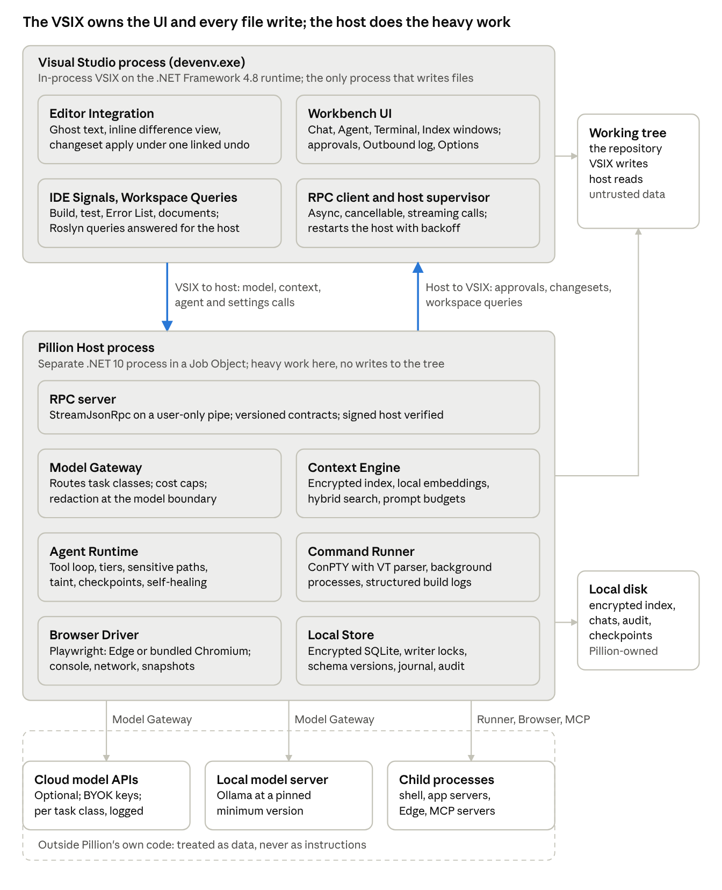
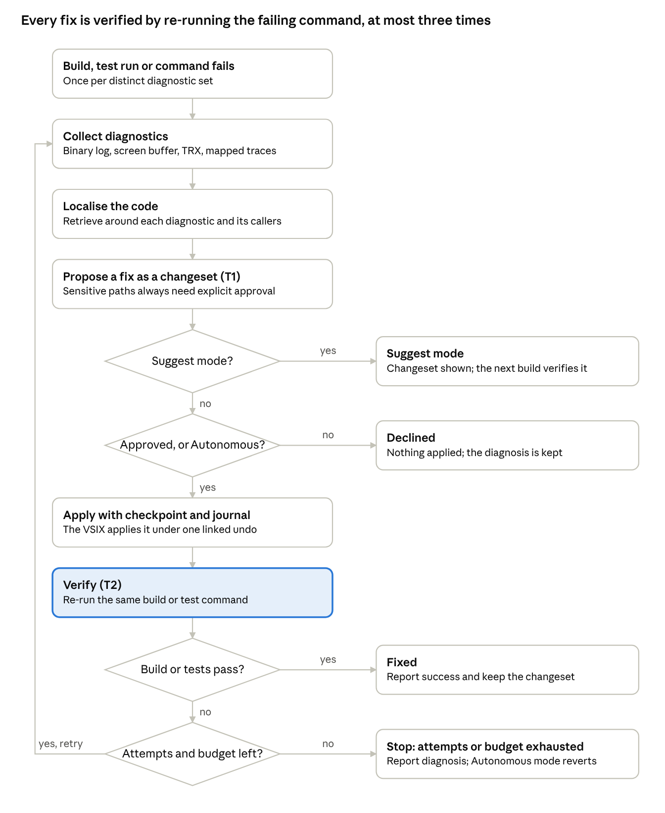
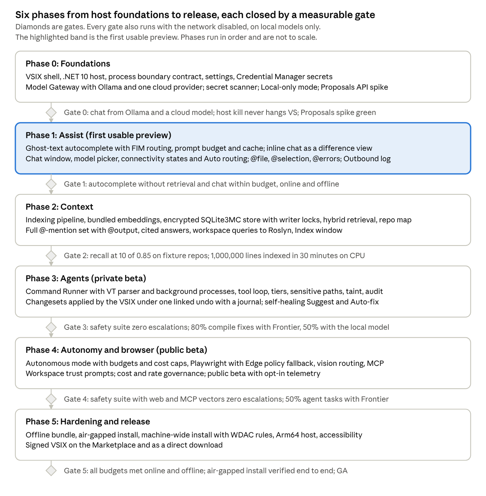

<!-- Exported from the Claude Doc https://claude.ai/code/artifact/02f3ee51-8712-47d2-89af-3c7f6f1559fb on 2026-10-08. The doc is the source of truth; re-export after changes. -->
<!-- Phase 2 notes (work item 2.18, 2026-10-15) were written into this export first and are mirrored into the Claude Doc by the lead; the original text is kept and each note says what changed. Phase 0 and phase 1 updates made in the Claude Doc after the export are not in this file. -->

> **Phase 2 notes.** Blocks like this one record what phase 2 (Context, work items 2.1 to 2.18, 2026-10-15) shipped where it differs from the text above them or adds to it. The original text stays for the record. Evidence: [phase-2-plan.md](phase-2-plan.md), [gate-2-report.md](gate-2-report.md), [eval-retrieval-baseline.md](eval-retrieval-baseline.md).

# Pillion Programmer: Software Design Document

Oct 8, 2026 · @Ryan

## 1. Introduction and vision

Pillion Programmer is a Visual Studio extension that seats an AI pair programmer behind the developer: it completes, explains, refactors, searches and repairs code and runs tools on request, while the developer keeps the handlebars. This document is the engineering baseline: it fixes the architecture, component boundaries, data design and delivery phases, and records the decisions behind them.

### Product summary

The extension adds three groups of capability to Visual Studio 2022 and 2026: code generation and assistance (ghost-text autocomplete, inline chat, multi-file editing), codebase context and search (a local semantic index, @-mention pinning, on-device embeddings) and autonomous agents (terminal access, self-healing builds and tests, browser automation). A model switcher routes each task to a cloud or local model. Every feature has a fully local path through Ollama or bundled models, so the product works with no internet connection. It is free and open source under the MIT licence, with no paid tier and no gated feature.

### Design principles

A pillion passenger can lean, point and hand the rider tools, but never grabs the handlebars. The same rules govern the product:

1. **The rider steers.** Every file change and every command is visible before it happens, previewable, and reversible in one action. Autonomy is opt-in per session and bounded by budgets, and it never extends to build files, scripts, package installs or anything that reaches the network without a human approval.
2. **Works on the back roads.** Each feature has a local-only implementation, and every release gate is also run with the network disabled. Connectivity makes the product faster or smarter, never possible.
3. **Code stays on the bike.** Nothing leaves the machine unless the developer has enabled a cloud provider for that kind of task, and every outbound request is logged where the developer can inspect it.
4. **Light on the IDE.** Heavy work runs in a separate host process. The Visual Studio UI thread never waits on a model, an index or a browser.
5. **Models are parts, not the product.** The harness (context, tools, permissions, UI) is the product. Any model that speaks a supported protocol can be swapped in.

### Target users

Professional developers on Windows using Visual Studio for .NET, C++ and web work, including teams in regulated or air-gapped environments where cloud AI tools are restricted or prohibited.

### Goals

- Ship the eleven requested features with parity between online and offline modes, differing only in model quality and speed.
- Keep Visual Studio responsive: no feature may add perceptible latency to typing, building or debugging.
- Make every agent action auditable and undoable.

### Non-goals

- Not a Visual Studio Code extension. VS Code has a different extension model and is out of scope for version 1.
- Not a hosted service. No Pillion server ever sees code, prompts or the index; cloud models are called directly with the user's own keys. The only vendor endpoints are the release page, a signed model catalog and an opt-in telemetry collector, and no feature depends on reaching them.
- Not a model trainer or fine-tuner.
- No team-shared or cloud-hosted index in version 1; the index is per machine.

## 2. Requirements

Eleven functional requirements (F1 to F11) map one-to-one to the requested features; nine non-functional requirements (NF1 to NF9) make offline parity, privacy and IDE responsiveness binding rather than aspirational. Later sections cite these IDs.

### Functional requirements

| ID | Feature | Requirement | Priority |
| --- | --- | --- | --- |
| F1 | Context-aware autocomplete | Show single-line and multi-line ghost-text suggestions while typing, built from the cursor prefix and suffix, the enclosing declaration, open documents and a bounded set of retrieved snippets. Tab accepts, Esc dismisses, a word-at-a-time accept exists. Multi-line suggestions end at the enclosing block. | Must |
| F2 | Inline chat and refactoring | With code selected, one shortcut opens an inline prompt. The proposal is shown as an inline difference view without changing the buffer, and is applied as one edit on Accept. | Must |
| F3 | Multi-file editing | One request produces one reviewable changeset across many files. Applying it is all-or-nothing: if any file fails to apply, files already changed are rolled back. One action, Revert changeset, reverts it, using Visual Studio undo while every file is still undoable and the checkpoint otherwise, with a three-way merge instead of an overwrite when a file changed after the apply. | Must |
| F4 | Semantic codebase search | Natural-language questions over the whole repository return ranked code locations and an answer that cites them. | Must |
| F5 | Context pinning (@-mentions) | Typing @ in any prompt attaches files, folders, symbols, docs, Output-window panes, terminal output, errors, git changes or the selection. Pins persist for the conversation and show their token cost. | Must |
| F6 | Local embedding generation | The index, including embeddings, is produced and stored on the local machine by an on-device model and encrypted at rest, as are checkpoints and conversations. Nothing is uploaded to build it. | Must |
| F7 | Terminal and CLI access | The agent runs commands, builds, tests and package installs in the Pillion terminal only under the user's approval mode; long-running app servers are managed as background processes. Output is captured for the agent and visible to the user. Package installs always need approval. | Must |
| F8 | Self-healing and auto-debugging | On a failed build, test run or command, the extension collects diagnostics, proposes or (with approval) applies a fix within a bounded number of attempts, and re-verifies by re-running the same command. | Should (Suggest mode is a Must) |
| F9 | Browser automation | The agent launches a headless browser against the running app, reads console and network errors, takes screenshots and asserts on rendered elements. Only localhost is reachable unless the developer allows another host. | Should |
| F10 | Model switcher | Users assign a model profile per task class or let an Auto policy choose by task complexity, cost and connectivity. Cloud routing is enabled per task class. Switching takes effect mid-conversation. | Must |
| F11 | Local LLM support (BYOK) | Ollama and any OpenAI-compatible local server are first-class providers for chat, completion and embeddings. Cloud providers use the user's own keys. | Must |

### Non-functional requirements

| ID | Quality | Requirement |
| --- | --- | --- |
| NF1 | Offline operation | All of F1 to F11 work with no network when a local model provider is present. No feature blocks, errors or times out because the internet is absent, and every release gate is also run with the network disabled. |
| NF2 | Privacy | A default install sends nothing off-machine. Cloud use is enabled per task class, every outbound request is logged, and a Local-only mode that disables all cloud providers can be enforced per repository by a policy file. |
| NF3 | Responsiveness | No synchronous waits on the Visual Studio UI thread. Typing latency is unchanged with autocomplete on. Numeric budgets are in section 13. |
| NF4 | Reliability | A crash in the host process never crashes or hangs Visual Studio. The host restarts automatically, interrupted work is reported as interrupted, and a half-applied changeset is rolled back or forward from its journal. |
| NF5 | Security | Agent actions are tiered, approved and audited. Edits to build files, scripts and policy always need approval. Secrets never reach logs, the index or a model prompt. |
| NF6 | Compatibility | Visual Studio 2022 17.14 and Visual Studio 2026 (18.x), on the operating systems those releases support, currently Windows 11 and Windows Server 2019 or later. Windows Server 2016 is excluded because it lacks a pseudo-console. x64 at launch; the Arm64 host ships in phase 5, before general availability. |
| NF7 | Resource ceilings | Host memory and CPU are capped and configurable. Indexing yields to builds, test runs and debugging. Cloud spend is capped per provider. |
| NF8 | Accessibility and theming | All UI follows the active Visual Studio theme, is keyboard-navigable, announces suggestions and changes to screen readers, never relies on colour alone, and is localised through resource files. |
| NF9 | Observability | Structured local logs, a diagnostics bundle, and a tamper-evident per-session audit trail that includes every outbound model request. Telemetry is opt-in and never contains code, prompts or file names. |

## 3. Constraints and assumptions

Code inside devenv.exe runs on the .NET Framework 4.8 runtime, in a process shared with Visual Studio and every other extension. All AI, indexing and execution work therefore moves into a separate .NET 10 process: to isolate crashes, hangs and memory growth from the IDE, to avoid assembly-version conflicts with libraries Visual Studio already loads (System.Text.Json, StreamJsonRpc, MessagePack), to keep native GPU and cryptography libraries out of devenv.exe, and to use .NET 10's performance and servicing. Several of those libraries do run on .NET Framework, so the split is a design choice, not a platform limit. Section 4 gives the architecture.

### Constraints

- **In-process code runs on the .NET Framework 4.8 runtime.** It targets .NET Framework 4.7.2 or 4.8, cannot load .NET 10 assemblies, and must bind to the assembly versions Visual Studio ships, including StreamJsonRpc.
- **Ghost text and editor adornments need in-process VS SDK APIs.** The out-of-process VisualStudio.Extensibility SDK does not yet expose inline proposals or Roslyn workspace access, so the integration layer is a classic VSIX. The Proposals API is public but Microsoft describes it as not finalised, so Gate 0 includes a spike that proves it on 17.14 and 18.x. We re-evaluate this each VS release.
- **No runtime downloads without consent.** Air-gapped and policy-managed machines cannot fetch models, browsers or runtimes. Anything the product needs ships in the VSIX or in an offline bundle.
- **Pseudo-console terminals need Windows 10 1809 or Windows Server 2019 or later.** Windows Server 2016, which Visual Studio 2022 still lists, is therefore unsupported; the matrix is in NF6.
- **Core VSIX size budget of 200 MB.** Larger optional assets (browser binaries, bigger embedding models, rerankers) live in the offline bundle or are downloaded on request.
- **Ollama is installed and run by the user.** Version 1 checks for a minimum Ollama version at start-up and ships an approval package (binaries, hashes, network behaviour) for air-gapped estates; a pinned, Pillion-managed llama-server in the offline bundle is the recorded alternative (section 19). The extension detects Ollama, configures it and recommends models, but does not bundle it.
- **Windows only.** Visual Studio has no macOS or Linux edition in scope.

* **Locked-down machines block executables in user-writable paths.** AppLocker defaults and many WDAC policies refuse to run anything under `%LOCALAPPDATA%`, and an Edge policy can block remote debugging, so the enterprise install is machine-wide and the bundled Chromium is the browser fallback (sections 8 and 16).

### Assumptions

- Every hardware configuration is supported, with local features degrading by GPU tier (section 6). The primary target profile is an Intel i9, 32 GB RAM and an RTX 3500 GPU with about 12 GB of VRAM; the development machine's 8 GB GPU is the floor on which budgets are measured. CPU-only machines run 1.5B to 7B parameter completion models under permissive licences; the research-licensed 3B Qwen2.5-Coder is not recommended.
- Solutions range up to roughly 10,000 files and 2 million lines of code, so indexing must be incremental and interruptible.
- Cloud models are reached directly through vendor APIs or an enterprise gateway with the user's own key. There is no Pillion backend to operate or trust.
- Licensing and data-processing terms of any chosen model, local or cloud, are the user's responsibility; the product shows which provider each request goes to.
- Git is the common version control system. Non-git folders still index, with exclusions coming from a `.pillionignore` file instead of `.gitignore`.
- The Visual Studio Marketplace may be blocked by policy, so side-loading a signed VSIX must be a supported installation path.

## 4. Architecture overview

Pillion Programmer is two cooperating processes: a thin integration layer inside Visual Studio, and a Pillion Host on .NET 10 that does everything expensive (model calls, indexing, embeddings, agent execution, browser automation). They talk over JSON-RPC on a named pipe under the contract below. The VSIX is the only process that writes to the repository working tree. If the host dies, Visual Studio keeps running, the VSIX relaunches it, and interrupted work is recovered from state on disk.



The VSIX inside Visual Studio holds the UI and the IDE hooks and is the only process that writes to the working tree. Every model call, index operation, command and browser session runs in the host, which calls back into the VSIX for approvals, changesets and Roslyn queries, and reaches a cloud provider only for task classes the developer has switched to cloud. Everything inside the dashed zone is outside Pillion's own code and is treated as data.

### Process model

| Process | Runtime | Lifetime | Holds |
| --- | --- | --- | --- |
| Visual Studio integration layer (VSIX) | .NET Framework 4.8 runtime, inside devenv.exe | Background-loaded when a solution or folder opens | Commands, editor providers, tool windows, build/test/error hooks, Options pages, the RPC client, the host supervisor, and the only code path that writes files |
| Pillion Host | .NET 10, self-contained; win-x64 at launch, win-arm64 from phase 5 | Started by the VSIX when a solution or folder opens; one per VS instance; runs inside a Job Object so it dies with devenv.exe | Model Gateway, Context Engine, Agent Runtime, Command Runner, Browser Driver, Local Store |
| Child processes | Varies | Per task; killed with the host's Job Object | Shell under a pseudo-console, background app servers, headless browser, MCP servers. The user-managed Ollama server is outside the Job Object |

### Component map

| Component | Process | Responsibility | Requirements |
| --- | --- | --- | --- |
| Editor Integration | VSIX | Ghost-text proposals, inline chat difference view, changeset application under one linked undo, journal commit | F1, F2, F3 |
| Workbench UI | VSIX | Chat, Agent, Terminal and Index tool windows; @-mention picker; approvals; Outbound log view; Options pages | F5, F10 |
| IDE Signals and Workspace Queries | VSIX | Build, test, Error List, document and solution events; Roslyn workspace queries answered for the host | F5, F8 |
| RPC Bridge | Both | StreamJsonRpc contracts in both directions, streaming, host lifetime, restart and health | NF4 |
| Model Gateway | Host | Provider adapters, routing and model switcher, prompt templates, redaction at the model boundary, caching, cost governance, secrets | F10, F11 |
| Context Engine | Host | Indexing, chunking, embeddings, hybrid retrieval, repo map, context assembly | F4, F5, F6 |
| Agent Runtime | Host | Tool loop, permission tiers, taint tracking, checkpoints and journal, multi-file edit plans, self-healing | F3, F7, F8 |
| Command Runner | Host | Pseudo-console execution, terminal emulation, background processes, output capture, process-tree kill | F7 |
| Browser Driver | Host | Playwright session, console and network capture, screenshots, accessibility snapshots, host allow-list | F9 |
| Local Store | Host | Encrypted SQLite databases for index, conversations and audit; checkpoints; settings; writer locks and schema versions | F6, NF9 |

### Cross-cutting rules

- Every RPC call is asynchronous and cancellable; the VSIX never blocks the UI thread waiting for the host (rules in section 13).
- The VSIX is the sole writer to the working tree. The host computes changesets; it never writes a file inside the solution.
- The host owns all state that must survive a Visual Studio restart. The VSIX holds only view state.
- Provider, index, tool and editor contracts live in one shared assembly targeting .NET Standard 2.0, so both processes compile against the same types.
- A feature flag gates every agent capability, so a policy file can switch individual tools off.
- Secrets are redacted where text leaves for a model, in the Model Gateway, and before anything is written to logs, the audit trail or the index, never at the process boundary (section 12).
- Repository content, tool output and web pages are data; nothing read from them can widen permissions (section 8).

### Process boundary contract

The contract is one versioned interface set in the shared contracts assembly. The major version must match on both sides; minor versions only add methods, so a newer VSIX can drive an older host during an upgrade.

| Interface | Direction | Methods (summary) | Style |
| --- | --- | --- | --- |
| `IModelService` | VSIX to host | `CompleteAsync` (fill-in-the-middle), `ChatAsync`, `CancelAsync`, `ListModelsAsync` | Token streams as `IAsyncEnumerable<T>`; 3 s cloud and computed local timeouts |
| `IContextService` | VSIX to host | `SearchAsync`, `ResolveMentionAsync`, `GetIndexStatusAsync`, `PauseIndexingAsync`; 1.3 adds `SearchDetailedAsync`, `SetWorkspaceAsync`, `ListExcludedFilesAsync`, `RebuildIndexAsync`, `DeleteIndexAsync`, `ListIndexesAsync` | Request and reply; 2 MB payload limit |
| `IConversationService` (1.3) | VSIX to host | `ListConversationsAsync`, `GetConversationAsync`, `CreateConversationAsync`, `RenameConversationAsync`, `DeleteConversationAsync`, `DeleteAllConversationsAsync`, `SetPinsAsync` | Request and reply; no append method, the host saves a turn as `ChatAsync` runs |
| `IAgentService` | VSIX to host | `StartSessionAsync`, `ApproveAsync`, `DenyAsync`, `StopAsync`, `RevertAsync`; 1.4 adds `AnswerApprovalAsync`, `ListSessionsAsync`, `GetSessionAsync`, `SendMessageAsync`, `SetApprovalModeAsync`, `RevertSessionAsync` | Session events as notifications (1.4: `agentSessionChanged`, `agentToolCall`, `agentChangesetReady`) |
| `ITerminalService` (1.4) | VSIX to host | `SendInputAsync`, `ResizeAsync`, `OpenDeveloperShellAsync`, `GetScreenAsync`, `ListTerminalsAsync`, `CloseTerminalAsync` | Request and reply; screens as the `terminalScreenChanged` notification, processes as `backgroundProcessChanged` |
| `IJournalService` (1.4) | VSIX to host | `BeginApplyAsync`, `CommitApplyAsync`, `AbortApplyAsync`, `ListInterruptedAppliesAsync` | Request and reply; the checkpoint and the journal intent before the VSIX's first edit, the commit after its last |
| `ISettingsService` | VSIX to host | `GetAsync`, `SetAsync`, `TestProviderAsync` | Request and reply; idempotent |
| `IEditorService` | Host to VSIX | `ApplyChangesetAsync`, `ShowPreviewAsync`, `GetOpenDocumentsAsync`; 1.4 adds `ReadDocumentAsync` | Request and reply; the only file-writing path |
| `IApprovalService` | Host to VSIX | `RequestApprovalAsync` (tool, tier, arguments, provenance, taint reason) | Request and reply; waits for the user with no timeout. From 1.4 the runtime does not call it: approvals are session state answered through `IAgentService` |
| `ITrustService` (1.4) | Host to VSIX | `RequestTrustAsync` (the `.pillion` contents and their hash) | Request and reply; waits for the user |
| `IWorkspaceQueryService` | Host to VSIX | `FindReferencesAsync`, `GetDiagnosticsAsync`, `GetSymbolAsync`, `RenameSymbolAsync`, `RunTestsAsync`; 1.3 adds `CallersOfAsync`; 1.4 adds `PlanRenameAsync` | Request and reply; off the UI thread; one in flight; 2 s budget |

- Serialiser: MessagePack over StreamJsonRpc. The VSIX binds to the StreamJsonRpc and MessagePack assemblies Visual Studio already ships rather than carrying its own.
- Error taxonomy: `ProviderUnavailable`, `ModelNotInstalled`, `ContextOverflow`, `PolicyDenied`, `ApprovalDenied`, `HostRestarting`, `Cancelled`, each with a user-facing message and a retry hint. Contract 1.3 adds `StorageUnavailable` and `NotImplemented`; 1.4 adds `BudgetExhausted`.
- Cancellation: every call takes a cancellation token; the host stops provider streams and child processes within 1 s of a cancel.
- Hardening: the VSIX verifies the host binary's Authenticode signature before launch, passes the handshake token over an inherited anonymous pipe (never the command line), opens the named pipe with the current-user-only option, and the host checks that the connecting client's process id is its parent devenv.exe.

> **Phase 2 note (2026-10-15, contract 1.3; work items 2.2, 2.9 to 2.15).** `ContractVersion` is 1.3. Everything below is additive, batched into one minor bump as the batching rule above and the decision of 2026-10-15 require; a 1.2 peer still passes the handshake (a 1.2 host answers a new method with method-not-found, a 1.2 client never calls it and ignores the new fields and notifications). Per-field orders are in `src/Pillion.Contracts/README.md`. Services added in phases 0 and 1 (`IInlineEditService`, `IDiagnosticsService`, `IHostLifecycleService`) are not in the table above either; that README lists them.
>
> | Area (work item) | Added in 1.3 |
> | --- | --- |
> | Conversations (2.2) | New service `IConversationService` (table above). DTOs `ConversationListRequest`, `ConversationPage`, `ConversationSummary`, `ConversationDetail`, `ConversationMessage` (role, content, model, provider, tokens, `Citations`, `Cancelled` for a reply stopped before it finished), `ConversationPin` (kind, target, display name, token count: what to resolve again, never the content), `ConversationCreateRequest`, `DeleteAllConversationsResult` |
> | Index status and control (2.9, 2.15) | `IndexStatus` grows `Phase` (`IndexPhase`: Idle, Discovering, Hashing, Chunking, Embedding, Storing, Paused, Failed), `PauseReason` (`IndexPauseReason`: None, User, Build, Test, Debug, Battery, Memory, LowDisk), `Roots` (`IndexRootStatus[]`: root path, index id, `Role` Writer or Reader, files indexed and found, excluded and secret-bearing counts, chunks, disk bytes, last full sweep, embedding model, chunker version, schema version), `ExcludedSecretFileCount`, `LastError`, `Progress` (`IndexProgress`: files and chunks done, estimated seconds remaining). Methods `ListExcludedFilesAsync` (`ExcludedFilesRequest`, `ExcludedFilesPage`, `ExcludedFile`), `RebuildIndexAsync`, `DeleteIndexAsync`, `ListIndexesAsync` (`IndexInfo[]`) |
> | Workspace and IDE activity (2.9, 2.10) | `SetWorkspaceAsync(WorkspaceDescription)`: solution path, project paths, opened folder; the host resolves the repository roots from it. `IdeActivity` flags (Build, Debug, Test) |
> | Search (2.11) | `SearchDetailedAsync` returns a `SearchResponse` (results, lexical, vector, fusion and total milliseconds, `Degraded`). `SearchRequest` grows `Roots`, `Partitions`, `Languages`, `Mode` (`SearchMode`: Hybrid, Lexical, Vector, Symbol), `MaxPerFile`, `IncludeText`, `FocusFiles`; `SearchResult` grows `ChunkId`, `Breadcrumb`, `Kind`, `Partition`, `Language`, `LexicalRank`, `VectorRank`, `FusedScore`, `Text`. `SearchAsync` is unchanged |
> | Citations and retrieval in chat (2.12) | `Citation` (zero-based `file:line` span, chunk id, breadcrumb, `ReplyOffset` or -1 for the whole reply); `ChatChunk.Citations` on the final chunk; `ChatRequest.RetrievalMode` (`Auto`, `On`, `Off`), `MaxRetrievedChunks`, `ExcludedContextKeys` (what the Context Inspector removed); `ContextReportItemDto.ContextKey`; `AutocompleteHostCounters.PromptPrefixChecks`, `PromptPrefixReuses`, `PromptPrefixReuseRate` |
> | Mentions (2.13) | `MentionKinds` names twelve kinds on the wire (the five of 1.2 and `symbol`, `docs`, `solution`, `git`, `output`, `build`, `tests`); `MentionRequest.Qualifier` and `Arguments`; `MentionResolution.Citations`. The pane text of `@output`, `@build` and `@tests` travels in the existing `Payload` |
> | Workspace queries (2.14) | `IWorkspaceQueryService.CallersOfAsync` (`CallersOfRequest`, `CallersOfResponse`, `CallSite`) |
> | Notifications (not methods on an interface) | Host to client: `indexStatusChanged` (the `IndexStatus`, at most twice a second, coalesced, not replayed to a late client). Client to host, the first of their kind: `ideActivityChanged` (the `IdeActivity` set in progress, 2.9), `documentSaved` (a full path, 2.10) and `openDocumentsChanged` (the open documents' full paths, 2.10). A host without a handler drops them; its file watcher still sees the files |
> | Error codes | `StorageUnavailable` (the Local Store cannot be opened or used: key, schema, migration, cipher) and `NotImplemented` (the method is on the contract, this host does not implement it; the message names the feature and the work item). A store that is switched off by its feature flag still answers `PolicyDenied`. Every 1.3 method is implemented by the end of phase 2 |
>
> Two members are declared but not driven yet: `IndexPauseReason.LowDisk` (nothing in the host raises it, so the 500 MB free-space pause in the failure table below is not implemented) and `IdeActivity.Test` (the extension reports builds and the debugger, so a test run pauses indexing only through its build).

> **Phase 3 note (2026-10-24, contract 1.4; work item 3.5).** `ContractVersion` is 1.4. Everything below is additive, batched into one minor bump at the boundary of phase 3's first wave as the batching rule above and the decision of 2026-10-24 in [phase-3-plan.md](phase-3-plan.md) require; a 1.3 peer still passes the handshake (a 1.3 host answers a new method with method-not-found, a 1.3 client never calls it, ignores the new fields and registers no handler for the new notifications). Per-field orders are in `src/Pillion.Contracts/README.md`, which also pins the order of every member of every DTO in a test. Until the consuming work items land, Pillion Host serves the three new VSIX-to-host services as stubs answering `NotImplemented` naming the work item, and the VSIX answers the three new host-to-VSIX methods the same way.
>
> | Area (consumer) | Added in 1.4 |
> | --- | --- |
> | Agent sessions (3.6, 3.7, 3.14, 3.17) | `AgentSessionRequest` grows `ConversationId`, `Pins` (the conversation's `ConversationPin`s) and `ApprovalMode` (`AgentApprovalMode`: `Ask`, `EditsAuto`, `Autonomous` reserved for phase 4 and refused by a phase 3 host). `IAgentService` grows `ListSessionsAsync`, `GetSessionAsync`, `SendMessageAsync` (follow-ups), `SetApprovalModeAsync`, `RevertSessionAsync` (every changeset of a session, newest first; the Agent window's primary revert) and `AnswerApprovalAsync(ApprovalDecision)`. The ledger `AgentSessionState`: goal, `Steps` (`AgentPlanStep`: title, `PlanStepStatus`, paths, sensitive paths), constraints, `Budgets` (`AgentBudgetUsage`: steps, tokens, cost, wall time, used and limit), the pending `ApprovalRequest`, the changesets (`AgentChangesetSummary`), status (`AgentSessionStatus`: Running, WaitingForApproval, Paused, Stopped, Completed, Failed), summary, error, model. `AgentToolCallRecord` (tool, tier, arguments summary, `ProvenanceKind` and detail, taint reason, status, result summary, duration, a stable `ToolCallId`). `ProvenanceKind` declares every source now: Unknown, User, RulesFile, RepositoryFile, ToolOutput, Terminal, Git, WebPage, McpServer. `TaskClass.AgentPlanning` at the end of the enum; `PillionErrorCode.BudgetExhausted` |
> | Approvals (3.6, 3.7, 3.14) | **Approvals are session state** (resolution 4 of the second plan review): the ledger carries the pending `ApprovalRequest`, which grows `SessionId`, `ToolCallId`, `ProvenanceKind`, `ChangesetId` (for a T1 apply) and `RequestedUtc`; the VSIX answers through the existing `ApproveAsync` and `DenyAsync` or the new `AnswerApprovalAsync`, and `ApprovalDecision` grows `RememberForSession`, `AddToAllowList` (never honoured for T3, a sensitive path or a tainted call) and `Preview` (the per-hunk decision for a changeset). An answer given after either process restarted still counts; waiting time is excluded from the wall budget. `IApprovalService.RequestApprovalAsync` stays on the contract, unused by the runtime |
> | Changesets and apply (3.10, 3.13) | `Changeset` grows `Creates` (`FileCreate`: path, content, expected hash), `Deletes` (`FileDelete`), `Renames` (`FileRename`), `ProjectItemChanges` (`ProjectItemChange`: add, remove, rename on projects that list items explicitly), `SensitivePaths` and `RevertsChangesetId` (a restore built by the host from the checkpoint; the VSIX may undo instead while the earlier changeset is still undoable, and opens a merge view where the expected hash no longer matches). `PreviewDecision` grows the accepted indices of the edits, creates, deletes and renames (`null`, what a 1.3 VSIX sends, means all). `ApplyResult` grows the per-file `FileApplyOutcome` (kind, applied, post-apply hash, message), `RolledBack` and the `CheckpointId` and `JournalId`. `IEditorService.ReadDocumentAsync(path)` returns `DocumentText` (the buffer, unsaved changes included, its hash; not open means read the disk). Every hash is the lower-case hex SHA-256 of the text as UTF-8, computed by the VSIX |
> | Journal and checkpoints (3.8, 3.13) | New VSIX-to-host `IJournalService` (resolution 2): `BeginApplyAsync(ApplyBeginRequest)` with the changeset id, the session and every file's pre-edit text (`ApplyFileSnapshot`, `null` text for a created file) returns `ApplyBeginResponse` (checkpoint and journal ids); `CommitApplyAsync(ApplyCommitRequest)` with the post-apply hash per file (`ApplyFileHash`); `AbortApplyAsync(journalId, reason)`; `ListInterruptedAppliesAsync()` returns the `ApplyJournalEntry`s with an intent but no commit or abort, each with the pre-edit text (roll-back) and the changeset (roll-forward). `Changeset` carries no checkpoint or journal id |
> | Terminal (3.11, 3.15) | New VSIX-to-host `ITerminalService`: `SendInputAsync`, `ResizeAsync`, `OpenDeveloperShellAsync` (`OpenDeveloperShellRequest`: `TerminalShell`, working directory, size; returns `TerminalInfo`), and, so a window that opens mid-session can catch up, `GetScreenAsync`, `ListTerminalsAsync`, `CloseTerminalAsync`. `TerminalScreen` (the rendered screen, cursor, the scrollback delta and total, a sequence number, the waiting-for-input flag, the exit code). `BackgroundProcessInfo` (command line, `BackgroundProcessStatus`: Starting, Ready, Exited, Stopped, Failed; port, URL, process id, exit code). `HandshakeRequest` gains the launching Visual Studio's installation path and version, kept by the host on `IVsixConnection.Client` for the Developer PowerShell environment. `MentionKinds.Terminal` |
> | Workspace trust (3.7, 3.14) | New host-to-VSIX `ITrustService.RequestTrustAsync(TrustRequest)`: the repository root, the `.pillion` folder, its content hash, its files (`TrustFile`: relative path, content cut at 64 KB, size), the previously trusted hash and the reason; `TrustDecision` (trusted, remember). `policy.json` applies whether or not the folder is trusted |
> | Workspace queries (3.24, 3.10) | `IWorkspaceQueryService.PlanRenameAsync(RenameSymbolRequest)` returns a `RenamePlan` (the proposed `FileEdit`s per file, the sensitive paths among them, `RenameConflict`s, truncated) without touching a file; the agent never calls the applied `RenameSymbolAsync` |
> | Notifications (not methods on an interface) | Host to client, none replayed to a late client: `agentSessionChanged` (the ledger), `agentToolCall` (a record when a call starts and when it ends), `agentChangesetReady` (session, changeset, the approval the apply waits for), `terminalScreenChanged` (at most 30 a second per terminal, coalesced), `backgroundProcessChanged`. The VSIX exposes them as `IHostConnection` events with no subscriber until 3.14 and 3.15 |
>
> Two things the plan's row names were shaped rather than added verbatim: the decision flags cannot travel on `ApproveAsync(approvalId)` and `DenyAsync(approvalId, reason)`, whose signatures are kept, so `AnswerApprovalAsync(ApprovalDecision)` sits beside them; and the approval-mode enum is `AgentApprovalMode`, because `Pillion.Common.Settings.ApprovalMode` (the settings default of phase 0, with `auto-safe`) already exists and both namespaces are open in the host and the extension. Declared but not driven in phase 3: `AgentApprovalMode.Autonomous`, `ProvenanceKind.WebPage` and `McpServer`.

### Failure modes and recovery

| Failure | Behaviour |
| --- | --- |
| Host crash or hang | The VSIX supervisor restarts it with 1 s, 5 s and 30 s backoff and stops after three crashes in five minutes, showing a Failed state with Open logs and Retry. In-flight replies are marked Interrupted with Retry; agent sessions resume from the ledger in a Paused state; running commands are reported as killed. |
| devenv.exe crash | The Job Object kills the host and its children, so no orphan holds GPU memory or a pseudo-console. |
| Half-applied changeset | The journal records intent before the first write and commit after the last; at the next start the VSIX offers to roll the changeset back or forward. |
| Provider outage | The circuit breaker opens, the fallback chain is used, and the status bar shows Degraded. |
| Index corruption or a newer schema | The host refuses to open a database written by a newer major schema and says so; a corrupt index is rebuilt in the background. |
| Out of disk | Indexing and checkpoints pause at 500 MB free and the user is told. |

> **Phase 2 note (2026-10-15, work items 2.1, 2.9, 2.15).** As built: a database written by a newer incompatible schema is refused with `StorageUnavailable` and a message naming both versions, and the file is not touched. An index that cannot be opened (missing or unreadable key, a key that does not fit, a damaged file) shows as Failed with its error in the Index window; it is not rebuilt in the background on its own, the developer chooses Rebuild or Delete there. The pause at 500 MB free disk is not implemented (see the note under the contract above). In flight, a half-written file is never visible: each file's row, chunks, vectors and symbols commit in one transaction.

The host moves through five states, Starting, Ready, Degraded, Restarting and Failed, shown in the status bar and the Agent window.

## 5. Visual Studio integration layer

The in-process layer is deliberately thin: it turns editor, build and test events into RPC calls, renders what comes back, answers the host's workspace queries, and applies changesets. It is the only code that writes files. Everything below is a classic VSIX built on the Visual Studio SDK, loaded as an `AsyncPackage` in the background when a solution or folder opens.

### Ghost-text autocomplete (F1)

- A MEF-exported proposal source built on the `Microsoft.VisualStudio.Language.Proposals` API receives caret and typing events and returns proposals; the editor draws the grey text and handles Tab and Esc natively. The API is public but not finalised by Microsoft, so a Phase 0 spike proves multi-line proposals, text to the right of the caret and virtual space on 17.14 and 18.x before anything else is built on it.
- Requests are debounced at 200 ms and the previous request is cancelled on every keystroke. The request carries the file path, language, prefix, suffix, caret position, the enclosing declaration, the open-document list and the last few edits; the host assembles the rest within the autocomplete prompt budget (section 7).
- Word-at-a-time accept and next/previous suggestion run through a command filter on the text view.
- Suggestions are suppressed in generated and designer files, files over 1 MB, and any language the user switches off.
- Fallback: if the Proposals API is unavailable in a target build, an intra-text adornment renderer with the same command filter draws the suggestion, and Tab is taken only when no other provider's proposal is visible.

### Completion shaping

- Single-line is the default. A multi-line request is made when the caret ends a line that opens a block, sits on an empty line inside a body, follows a declaration signature, or when the previous suggestion was accepted at a line end.
- Multi-line output stops at the end of the enclosing block (brace matching for C-family languages, dedent for Python, the tree-sitter node otherwise), at 30 lines, or at the first line that duplicates text already below the caret.
- Intent signals sent with the prefix and suffix: the enclosing declaration and its doc comment, the file's imports, the symbols edited in the last five minutes, and the test or caller that references the current member when the index knows it.

### Suggestion coexistence

- At start-up the extension detects GitHub Copilot and IntelliCode whole-line completions and offers to disable one side, or to run Pillion suggestions on demand only.
- Pillion never takes Tab while another provider's proposal is visible, and never shows a proposal while a completion list has a selected item.
- Integration tests run on the latest 17.14 and 18.x builds with Copilot enabled.

### Inline chat and refactoring (F2)

- A keyboard command opens a WPF adornment anchored above the selection with a one-line prompt, a model picker and recent prompts. With nothing selected, the scope is the enclosing member (Roslyn for C# and VB, the host's parsers for other languages, otherwise the current line).
- The proposal is shown without touching the buffer: an inline difference view (`IDifferenceBufferFactoryService` with an `IWpfDifferenceViewer` in inline mode) hosted in the adornment, with +/- markers as well as colour. The document stays clean, so Roslyn, the file watcher and Live Unit Testing never see partial code.
- Enter applies the proposal as one `ITextEdit`; Esc discards it with nothing to undo; a follow-up prompt refines the proposal in place.
- Slash shortcuts in the prompt (`/doc`, `/test`, `/fix`, `/explain`) prefill common tasks; `/fix` attaches the diagnostics on the selected lines.

### Tool windows

| Window | Purpose |
| --- | --- |
| Chat | Conversations, model picker (F10), approval-mode selector, context pins with token badges (F5), the Context Inspector for chat requests, and the Outbound log of every request sent to any model |
| Agent | Task ledger (plan steps and status), live tool-call log with approve and deny buttons and the provenance of each instruction, changeset view, background processes, checkpoints with Revert changeset |
| Terminal | A VT-parsed screen buffer with scrollback for the Pillion terminal, an input line for interactive prompts, and Open in Developer PowerShell. The Pillion terminal is separate because Visual Studio's integrated terminal has no public API; commands the developer runs there are not visible to `@terminal` |
| Index | File and chunk counts, progress, pause and resume, exclusions, Rebuild, encryption status, disk use per index |

> **Phase 2 note (2026-10-15, work items 2.2, 2.12, 2.13, 2.15).** The Index window shipped as designed except that it shows no separate encryption status (every index is encrypted) and its Rebuild and Delete act per root and per index folder; it has three tabs, a status bar indicator and an Indexing options page, described in [index-window.md](index-window.md). The Chat window's conversation list now reads the host's saved conversations (they survive a restart), replies cite `file:line` spans (explicit citations are links that select the span, implicit ones sit under a collapsed Sources line), and the Context Inspector can remove a retrieved chunk or the repo map before sending. The Terminal and Agent windows are later phases.

All windows are WPF, themed from Visual Studio's colour resources. Markdown renders through Markdig with remote images disabled and links opened only after confirmation; code blocks render in embedded editor views so they get native colourisation and a one-click Insert at cursor.

### Changeset preview and apply (F3)

- The host sends a changeset: file edits, creates, deletes, renames and project-item changes. The changeset view lists every touched file with an inline diff and per-hunk Accept and Reject, all keyboard-accessible; Open in VS Diff shows the side-by-side comparison through the IDE's difference service.
- Apply runs entirely in the VSIX. It asks source control for checkout through `IVsQueryEditQuerySave2`, opens closed files through `IVsInvisibleEditorManager` (or the Roslyn workspace for C# and VB), applies every text edit inside one linked undo transaction, and performs project-item adds, deletes and renames through the project system in the same transaction.
- Apply is all-or-nothing. The checkpoint and a journal intent record are written before the first edit; if any file fails to apply, the files already changed are rolled back and the journal is marked aborted; otherwise it is marked committed.
- Revert changeset uses Visual Studio undo while every file in the set is still undoable, and the checkpoint otherwise. It compares each file's current hash with its post-apply hash and opens a three-way merge instead of overwriting when a file changed after the apply.

### IDE signals and workspace queries

| Signal | Source | Used for |
| --- | --- | --- |
| Build started and finished | Solution build manager events | Pause indexing during builds; trigger self-healing on failure (F8) |
| Build diagnostics | The MSBuild binary log for agent-run builds; Error List entries otherwise, noting that the list reflects the developer's current filters | `@errors` and `@build` pins; Fix with Pillion; self-healing input |
| IntelliSense errors | Roslyn diagnostics from the workspace | `@errors`; `/fix` |
| Test results | Agent-run tests use a TRX logger or the Microsoft.Testing.Platform report. Test Explorer has no documented event API, so its hooks are treated as version-fragile and covered by per-version integration tests | `@tests` pin; self-healing on failed tests |
| Document opened, saved, closed | Running Document Table events | Incremental re-index of saved files; open-document context |
| Symbols and references | The live Roslyn workspace, queried by the host through `IWorkspaceQueryService` off the UI thread within a 2 s budget | `@symbol`, `find_references`, `callers_of`, `rename_symbol`, citations |
| Output window panes | Build, Debug and Tests panes | `@output` pin |

> **Phase 2 note (2026-10-15, work items 2.9, 2.10, 2.13, 2.14).** The signals the indexer uses reach the host as contract 1.3 notifications: builds and the debugger as `ideActivityChanged`, saves as `documentSaved`, the open documents as `openDocumentsChanged`. Test Explorer has no hook, so a test run pauses indexing only through its build, and `@tests` pins the Tests pane's text. The workspace-query budgets (one in flight, 2 s, at most five a second) are enforced in the VSIX; over the concurrency or rate limit a call fails at once with `Cancelled`, and one that reaches 2 s returns what it found marked truncated.

### Commands and default shortcuts

Defaults are two-keystroke chords under one prefix that the audit confirms is unbound in every built-in Visual Studio keyboard scheme and in Copilot and ReSharper; the candidate prefix is Ctrl+Alt+Shift+P. The audit result replaces this table before beta.

| Command | Default (provisional) | Scope |
| --- | --- | --- |
| Open Pillion Chat | Prefix, then C | Global |
| Inline chat on selection | Prefix, then I | Editor |
| Start agent task | Prefix, then A | Global |
| Accept suggestion, accept next word | Tab, Ctrl+Right | Editor, when a Pillion suggestion is visible |
| Next and previous suggestion | Alt+\], Alt+\[ | Editor |
| Fix with Pillion, Explain, Add tests, Document | Context menus | Error List and editor |

### Accessibility

- A new ghost-text suggestion raises a UI Automation notification so screen readers announce it; the announcement can be switched off.
- Diffs carry +/- markers and text alternatives, never colour alone; colours come from Visual Studio theme keys, including the high-contrast themes.
- The inline adornment, the approve and deny buttons and per-hunk accept and reject are in the tab order and have keyboard equivalents.

### Localisation

- All UI strings live in resource files and are tested with pseudo-localisation; Visual Studio's 14 UI languages are the target set.
- Models are asked to answer in the IDE's language unless the developer sets another; code and identifiers are never translated.
- Non-English code bases can select the multilingual embedding model (section 7).

### Settings

Options pages cover Providers and keys, Models and routing (with a cloud switch per task class), Privacy, Agent approvals, Indexing, Browser and Cost caps. The host owns the settings file; the pages are a view over it, so settings survive a VS reinstall.

## 6. Model Gateway and model switcher

The Model Gateway is the only component that talks to a language model. It offers one chat, one code-completion and one embedding interface to the rest of the host, routes each request by task class, connectivity, capability, cost and policy (F10, F11), and is where secrets are redacted and spend is governed.

### Provider abstraction

- Built on the Microsoft.Extensions.AI abstractions (`IChatClient` and `IEmbeddingGenerator`) with middleware for logging, caching, function invocation and OpenTelemetry. A third interface covers fill-in-the-middle (FIM) completion, which the chat abstraction does not model.
- Every configured model carries a capability descriptor: context window, maximum output, tool calling (native or none), vision, FIM, streaming, prompt caching, cost per token, and whether it is local.
- Adapters are built in. Third-party providers connect through OpenAI-compatible endpoints or MCP (section 14); in-process provider plug-ins are out of version 1.

| Provider | Protocol | Chat | FIM | Embeddings | Vision and tools | Works offline |
| --- | --- | --- | --- | --- | --- | --- |
| Ollama, native API | HTTP on localhost:11434 | Yes | Yes, via the `suffix` parameter, for models whose template supports it | Yes | Model-dependent | Yes |
| OpenAI-compatible local servers (LM Studio, llama.cpp server, vLLM, LocalAI) | HTTP `/v1` | Yes | Where the server supports completions with suffix; llama.cpp's `/infill` endpoint through a dedicated adapter | Yes | Model-dependent | Yes |
| Anthropic (Claude) | HTTPS | Yes | Chat-framed only | No | Yes | No |
| OpenAI and Azure OpenAI | HTTPS | Yes | Chat-framed only | Yes | Yes | No |
| Google Gemini | HTTPS | Yes | Chat-framed only | Yes | Yes | No |
| Mistral | HTTPS | Yes | Codestral FIM through a dedicated adapter (not an OpenAI-compatible endpoint) | Yes | Varies | No |
| OpenAI-compatible cloud gateways (OpenRouter, enterprise proxies) | HTTPS `/v1` | Yes | Chat-framed only | Varies | Varies | No |
| Bundled ONNX embedding model | In-process ONNX Runtime | No | No | Yes | No | Yes |

> **Phase 2 note (2026-10-15, work items 2.6, 2.7).** The embedding column is implemented for Ollama (`/api/embed`), OpenAI-compatible servers, Mistral, Azure OpenAI, Gemini (`embedContent`, `batchEmbedContents`) and the bundled ONNX provider. Anthropic has no embeddings endpoint. The `Embedding` task class stays local: `cloudSwitches.embedding` is off by default, Local-only always wins, and under Auto a cloud embedding model is used only when a profile or the request names one. The catalog's provider order tries the bundled model first, whether or not an Ollama embedding model is installed (provisional until the default is decided, issue #95). An Ollama embedding model is loaded with a small `num_ctx` and never pushes a resident chat or completion model off the GPU; when it would, it runs on the CPU.

### Task classes, profiles and the Auto policy

Users do not pick a model per request. They assign a model profile (Fast, Balanced, Frontier, Local-fast, Local-strong) to each task class, or leave the class on Auto. Profiles map to concrete model ids in the signed model catalog, which is data, not code; the design names no model. The profile used for autocomplete must be FIM-capable (a Codestral-class cloud model, or a local Qwen2.5-Coder-class model); chat-only fast models serve Summarise.

| Task class | Auto choice when online | Auto choice when offline |
| --- | --- | --- |
| Autocomplete | Local-fast when a GPU is present; the cloud Fast FIM model only if cloud autocomplete is switched on | Local-fast FIM coder |
| Inline edit | Balanced | Local-strong |
| Chat | Balanced; Frontier when the assembled context exceeds 32k tokens or `@solution` is pinned | Local-strong |
| Agent planning | Frontier | Local-strong, text-protocol tool calls |
| Agent step | Balanced; escalates to Frontier after two failed verifications, with confirmation once the session passes its cost threshold | Local-strong |
| Embedding | Local, always | Local |
| Vision (browser screenshots) | Frontier with vision | Local vision model if installed, otherwise accessibility snapshot text |
| Summarise (context compression) | Fast | Local-fast |

Routing rules apply in this order: policy (Local-only mode or a repository policy file restricts to local providers); the per-task-class cloud switches (a cloud key enables chat only; autocomplete, agent and self-healing each need their own switch under Options, Privacy, and the status bar shows which task classes are cloud-routed); connectivity (an unreachable provider yields to the next in its fallback chain); capability (tools, vision, FIM, context size); cost caps (a provider over its cap is skipped); then the user's per-conversation override, which always wins over Auto. The reply header names the model that answered.

Complexity signals for Auto: the task class, the number of files in the agent plan, the diff size, whether tests are touched, the assembled context size, the verification failure count, and an explicit Think harder control. Each profile carries a reasoning-effort or thinking budget where the provider supports one.

### Local model residency

- Every local request sends a fixed context size (`num_ctx`) per profile. The server never picks one, because changing it reloads the model and the default silently truncates prompts.
- What stays resident depends on the GPU tier below; `OLLAMA_MAX_LOADED_MODELS` and `keep_alive` are set to match, and the status bar shows which models are resident.
- The first request after a cold load shows progress rather than failing.
- A minimum Ollama version is checked at start-up; the approval package in section 11 lists the pinned version.

| Tier | Resident models | Notes |
| --- | --- | --- |
| CPU only | A 1.5B FIM coder; chat with a 3B to 7B model on CPU, or a cloud profile | Autocomplete within the 1,024-token budget |
| 8 GB GPU (the development machine) | One 7B FIM coder; chat shares it or runs on CPU | The floor on which every budget is measured |
| 12 GB GPU (the primary target profile: Intel i9, 32 GB RAM, RTX 3500) | A 1.5B FIM coder plus a 14B chat model at Q4 with an 8k context, or a 7B FIM coder plus an 8B chat model | Tight; the pairing is verified at the offline agent gate when the hardware is available |
| 16 GB GPU | A 7B FIM coder plus a 14B chat model |  |
| 24 GB GPU or more | A 7B FIM coder plus a 32B chat model |  |

### Prompt templates

- Templates are YAML data files shipped with the host and overridable by the user: system prompt variants for tool-capable and text-protocol models, FIM token formats per family (Qwen2.5-Coder, CodeLlama, StarCoder2, DeepSeek-Coder, Codestral), stop sequences and output defaults.
- Ollama applies a model's FIM template itself when `suffix` is passed; raw llama.cpp servers receive explicit FIM tokens from the template.
- Project rules from `.pillion/rules.md` (after workspace trust) and the user's personal rules are appended to chat, inline and agent system prompts, never to autocomplete prompts.
- Prompt sections are ordered from most to least stable (system, rules, repo map, pins, history, query) so provider-side prompt caching hits on the long stable prefix.

### Streaming, caching and resilience

- Tokens stream provider to host to VSIX as JSON-RPC notifications; the UI renders partial markdown as it arrives.
- Autocomplete cache: an LRU keyed by model, a hash of the prefix tail and a hash of the suffix head; serves repeated keystrokes and backspaces without a request. Accepting a suggestion immediately requests the next one.
- Timeouts: a 3 s hard limit for cloud autocomplete and 60 s to first token for cloud chat and agent calls. Local timeouts scale with prompt size and the measured prompt-evaluation rate of the resident model, so a slow local model shows progress instead of failing (NF1).
- Retries with jitter on 429 and 5xx for everything except autocomplete. A circuit breaker per provider opens after three consecutive failures for 60 s and feeds the connectivity state in section 11.
- Redaction: the secret scanner runs here on everything bound for a cloud model, and placeholders map back to the originals per request before any edit is applied (section 12). Local providers receive unredacted text by default; policy can require redaction for them too.

### Cost and rate governance

| Control | Default |
| --- | --- |
| Concurrency per provider | Autocomplete 1 in flight, chat 2, agent 1, so a 429 storm from autocomplete cannot starve chat |
| Client-side token buckets | Per provider, sized from the provider's published limits |
| Spend caps | Daily and monthly per provider; warn at 80%, stop at 100%; enforceable by policy |
| Autocomplete | No rules injection; cloud autocomplete prompts capped at 2,048 tokens; cache hit rate measured |
| Self-healing | Triggered only by builds and test runs the developer or the agent started, once per distinct diagnostic set (a hash of the error set) |
| Escalation | Confirmation before a session escalates to Frontier once it passes a set cost |
| Visibility | Running cost in the status bar; per-conversation and per-day totals in the Chat window |

### Secrets and endpoints

- API keys live in Windows Credential Manager under a `PillionProgrammer/<provider>` target, never in settings files, logs or RPC traces.
- Each provider supports a custom endpoint, the system or an explicit proxy, and a custom CA bundle for enterprise gateways. Azure OpenAI can use Entra ID credentials instead of a key.
- A provider without a valid key is hidden from routing; a Test connection button verifies before saving.

## 7. Context Engine: indexing, embeddings and search

The Context Engine maintains a local, encrypted index of the repository and answers one question for every feature: which few thousand tokens of code should this request see? It fuses lexical search, vector search and a symbol graph, all computed on the developer's machine (F4, F5, F6). Symbols in the index are syntax-derived and marked approximate; precise answers for C# and VB come from the live Roslyn workspace through the VSIX (section 5).

### Indexing pipeline

1. **Discover.** Enumerate the repository roots the solution's projects live in. Apply `.gitignore` rules, `.pillionignore`, built-in exclusions (`bin`, `obj`, `node_modules`, `.git`, `.vs`, `packages`), generated and minified files (`*.g.cs`, `*.designer.cs`, `*.min.js`, lock files, files with an auto-generated header), binary detection and a 1 MB file cap. Secret-bearing files (`.env`, `*.pfx`, `*.pem`, `*.key`, `secrets.json`, `appsettings.*.json`) are excluded by default, listed in the Index window, and unreadable by agent tools without per-file approval (section 8).
2. **Hash.** Store an xxHash64 content hash per file; unchanged files are skipped. A branch switch triggers a hash sweep, not a rebuild.
3. **Parse and chunk.** Roslyn syntax trees for C# and VB (no compilation needed); tree-sitter grammars for TypeScript, JavaScript, Python, C and C++, Go, Rust, Java, SQL, HTML and CSS; Razor is split into its C# and markup parts; anything else falls back to a 60-line window with 10 lines of overlap. A chunk is one syntactic unit (a member with its doc comment, or a type header), prefixed with a breadcrumb `path > namespace > type > member`. The chunk cap is expressed in the embedding model's own tokenizer and read from the model manifest, with room left for the breadcrumb: 512 WordPiece tokens for the bundled model, which code reaches sooner than BPE counts suggest.
4. **Extract symbols.** Syntax-derived definitions and name-based references for every language feed the symbol table and reference edges; all are marked approximate.
5. **Embed.** Batches of 32 chunks through the active embedding model, the bundled ONNX model by default. Vectors are unit-normalised, then quantised to int8; the recall loss against float32 is measured on the retrieval set and must stay within 2 points. The DirectML execution provider is used when a GPU is present, with an FP16 model variant for that path, because int8 models may not accelerate under DirectML.
6. **Store.** One encrypted SQLite database per repository root (schema in section 10).
7. **Watch.** A file-system watcher on repository roots with 500 ms debounce, save events relayed from Visual Studio, and a watch on the real git directory's `HEAD` (resolved through worktrees and submodules) for branch switches. Indexing pauses during builds, test runs and debugging, and on battery saver.

> **Phase 2 note (2026-10-15, work items 2.3 to 2.5, 2.9, 2.10): the pipeline as built.** The seven steps ran as designed; these are the differences and the details the design left open.
>
> - **Discover.** Roots come from the git top-level of each project path the extension relays (a linked worktree's or submodule's `.git` file is followed to the real git directory) or from the opened folder; a nested repository is indexed under its own root. Thirteen rules apply in a fixed order and each excluded path keeps its reason (full table in `src/Pillion.Indexing/README.md`, user view in [pillionignore.md](pillionignore.md)): reparse points are never followed; secret-bearing names come first (`.env`, `.env.*`, `*.pfx`, `*.pem`, `*.key`, `*.p12`, `secrets.json`, `appsettings.*.json`, `*.publishsettings`, `id_rsa`, `id_dsa`, `id_ecdsa`, `id_ed25519`, `*.ppk`, `*.jks`, `*.keystore`, `.netrc`, `.pgpass`) and such a file is never opened, hashed or stored; then `.gitignore` at every level, the root `.pillionignore`, built-in names, the `indexing.exclude` setting and the policy `exclude`, generated and minified names and lock files, the 1 MB cap, generated headers in the first 2 KB, and binary detection (a NUL byte in the first 8 KB). **The `packages` built-in is narrower than the design's list:** it excludes only a folder at the repository root that looks like a NuGet packages folder (a `repositories.config`, or a `*.nupkg` one or two levels down); any other `packages` folder is source. **A `!` rule in the root `.pillionignore` re-includes** a built-in name (`!packages/`, `!bin/`; not `.git`) and anything `.gitignore` ignored; `indexing.exclude` and the secret list cannot be opted back in to. The gitignore syntax is Pillion's own implementation, compiled to string comparisons or non-backtracking regular expressions, so a hostile pattern cannot slow matching down.
> - **Hash.** `XxHash64` from `System.IO.Hashing`. A file whose size and modified time match its stored row is not even opened; a row written within 2 seconds of its file's time is hashed again (git's "racily clean" rule). A branch switch is a sweep of this kind, never a rebuild.
> - **Parse and chunk.** The tree-sitter grammars come through the **TreeSitter.DotNet** 1.3.0 binding (MIT, prebuilt win-x64 and win-arm64 native libraries; the project copies the 12 libraries the chunkers load). The binding ships no SQL grammar, so SQL is chunked by Pillion's own statement lexer. Razor is split into its C# and markup parts. A parse that fails badly (Roslyn: more than one syntax error per 20 lines; tree-sitter: more than 30% of the text in error nodes) falls back to the 60-line window. The chunk cap is the smaller of the model's own input size and 512 tokens, counted in the model's tokenizer with the breadcrumb included. `ChunkerVersion` is part of the index identity.
> - **Extract symbols.** A definition's id is a hash of path, container, name, kind and **overload ordinal** (no line number), so an edit that moves a definition keeps its id and the edges other files hold to it. `symbols_version` is stored separately from `chunker_version`: when only symbol extraction or resolution changes, the symbols are rebuilt without re-chunking or re-embedding. References are resolved by name and marked approximate; an ambiguous reference becomes one edge per candidate (at most five) flagged ambiguous, and more candidates give none.
> - **Embed.** Batches of 32 through the Model Gateway, the model pinned by id so one index never mixes models; a failed batch is retried three times (1, 2 and 4 s) before the run stops as Failed with the files already stored kept. Under memory pressure (`indexing.maxMemoryMb`, 1,536 by default) the host compacts once, halves the batch (32, 16, 8, 4), then pauses; it resumes below 90% of the cap. The ONNX Runtime memory pattern is off on the CPU and a run is capped at 512 x 512 attention cells, which cut peak memory from over 2 GB to about 315 MB on this repository and made it about 50% faster.
> - **Store.** One transaction per file holds its row, chunks, FTS5 rows, vectors and symbols. After the first stored batch, and then at most every `max(10 s, 10 x the last refresh)`, the symbol graph and the in-memory vector copy are refreshed, so partial results are searchable while the run goes on (first results after 2.5 to 9.5 s in the Gate 2 runs).
> - **Watch.** A recursive `FileSystemWatcher` per root this host owns feeds a queue with the 500 ms debounce (a burst is handed over together after at most 1 s); events are filtered by the discovery rules first, so changes under `bin`, `obj`, `.git` or an ignored folder cost a string check. A watcher on the real git directory sees `HEAD` and `index.lock`: when git is done and the directory has been quiet for 300 ms, a changed checked-out commit asks for a hash sweep. The `documentSaved` notification hands a saved file to the incremental indexer at once, bypassing the debounce; its chunks whose breadcrumb and text did not change keep their stored vectors (in every run, full or incremental), the new ones are embedded in batches of 8 while the 500 ms budget lasts, and a large new file is searchable lexically at once and by vector in part, the rest following right after. `openDocumentsChanged` lets a branch-switch sweep index the open documents first. If the watcher fails, the root is swept again and the watcher is retried every 5 minutes.
> - **Pauses and priority.** Pipeline work runs on half the logical processors at below-normal priority. Pause reasons are reported in the order User, Memory, Build, Test, Debug, Battery, LowDisk when several hold; the host honours Test but the extension never reports it, and nothing raises LowDisk (see the note under the contract in section 4). Battery saver is read every 15 s and `indexing.pauseOnBattery` is on by default.

### Embedding models (F6)

| Model | Parameters | Dimensions | Approximate size | Role |
| --- | --- | --- | --- | --- |
| bge-small-en-v1.5, int8 ONNX | 33M | 384 | 35 MB | Bundled default: ships in the VSIX, fast on CPU, English-only, acceptable on code |
| jina-embeddings-v2-base-code, int8 ONNX | 161M | 768 | 165 MB | Code-trained upgrade, 8k-token input; offline bundle or on-request download; its custom architecture means the ONNX export is validated by the retrieval benchmark |
| multilingual-e5-small, int8 ONNX | 118M | 384 | 120 MB | For non-English comments, docs and questions |
| nomic-embed-text through Ollama | 137M | 768 | 275 MB | For users who prefer Ollama to manage every model |

Switching embedding models re-embeds the whole index in the background; the old index serves queries until the new one completes. The shipped default is confirmed by the retrieval benchmark in section 15.

> **Phase 2 note (2026-10-15, work items 2.6, 2.7, 2.16, 2.17): models as built and measured.**
>
> - **What ships.** The bundled provider runs ONNX Runtime 1.24.4 (the DirectML package, which carries both the CPU and the DirectML execution providers) in the host. `bge-small-en-v1.5` (`model_quantized.onnx`, 34.0 MB, 384 dimensions, 512 WordPiece tokens, CLS pooling, MIT) is in the VSIX under `Host\models\`. `multilingual-e5-small` (118.3 MB, mean pooling) and `jina-embeddings-v2-base-code` (161.9 MB, 768 dimensions, Apache-2.0, input capped at 2,048 tokens) are downloaded on request from pinned URLs and verified by SHA-256 and size against a manifest compiled into `Pillion.ModelGateway.dll`; nothing is fetched under Local-only. The optional FP16 graph of bge-small (66.7 MB) is not bundled. Ollama's `qwen3-embedding:0.6b` works through the Ollama adapter; `nomic-embed-text` was not run (not pulled on the reference machine).
> - **Switching models.** The model id is part of the index identity, so a different model opens a different index and builds it from scratch; the design's rule that the old index serves queries until the new one completes is not implemented as a separate behaviour. The old index goes away through retention or from the Index window.
> - **Measured baseline** (work item 2.16, hybrid mode, 60 hand-checked queries over this repository's `src`, 601 indexed files, about 10,000 chunks; reference machine, 2026-10-15; bundled models on the CPU, qwen3 on the GPU; one query is 1.7 points, so one or two queries are within noise):
>
> | Model | Recall@10 by file | MRR by file | Recall@10 by symbol | Query p50 / p95 | Index time |
> | --- | ---: | ---: | ---: | ---: | ---: |
> | bge-small-en-v1.5 (bundled) | 0.967 | 0.831 | 0.750 | 12 / 16 ms | 259 s |
> | qwen3-embedding:0.6b (Ollama, GPU) | 1.000 | 0.814 | 0.700 | 28 / 33 ms | 356 s |
> | jina-embeddings-v2-base-code | 0.967 | 0.826 | 0.783 | 23 / 31 ms | 852 s |
> | multilingual-e5-small | 0.950 | 0.764 | 0.767 | 11 / 14 ms | 328 s |
>
> The int8 loss against float32 is 0.0 points for all four models (file MRR moved by at most 0.008), well inside the 2 points. Every model clears the proposed 0.85 gate on this set; the 0.90 target for the code model cannot be judged until it runs on the three external fixture repositories (issue #50). **The default is not changed by this note**: the catalog still tries `bge-small-en-v1.5` first and the choice waits on the product owner (issue #95; the lead's recommendation is to keep bge-small as the default and the others selectable).
> - **DirectML.** The int8 graph does accelerate under DirectML, contrary to the design's expectation: in the isolated benchmark of full 512-token batches it ran at 55.2 chunks/s against 14.1 on the CPU (3.9 times; work item 2.7 measured about 62 against about 9, issue #78). In the indexing pipeline on real code it did not help: 33.6 chunks/s against 45.2 on the CPU (5.20 against 3.86 minutes per 100,000 lines) and only 8% faster on generated code; the likely cause is the attention-cell cap set for the CPU's memory, which splits mixed-length chunks into many small runs that DirectML pays dispatch for. The FP16 graph was not measured in the pipeline. DirectML ships under Microsoft's own terms with a data-collection clause; whether it stays the default is issue #78.

### Storage

- **Lexical:** FTS5 with a custom tokenizer that splits camelCase and snake\_case while also keeping the whole identifier as a token; BM25 ranking.
- **Vector:** a sqlite-vec `vec0` table with int8 vectors. Its metadata filters support equality and range comparisons only, so path scoping uses a precomputed partition column (project or top-level folder) rather than a prefix match. Brute-force nearest-neighbour search is adequate to about 500,000 chunks; an `IVectorIndex` abstraction allows an HNSW backend for larger monorepos. sqlite-vec is pre-1.0 and is statically linked into our SQLite build and pinned.
- **Symbols:** `symbols` and `symbol_refs` tables. The repo map ranks files and symbols by PageRank over the reference graph and renders the top of the ranking as a compact outline.
- **Encryption:** an in-house SQLite3MultipleCiphers build (MIT) with sqlite-vec statically linked, for x64 and Arm64, because the free SQLCipher packages for .NET are deprecated. Each database has its own 256-bit key, protected with Windows DPAPI for the current user and stored beside the database under `%LOCALAPPDATA%` with a user-only ACL. The same build encrypts conversations and checkpoints. This protects data at rest against other OS users, lost disks and backups; it does not protect against software running as the developer.
- **Ownership:** one writer per database, elected through a lock file (section 10).

> **Phase 2 note (2026-10-15, work items 2.1, 2.5, 2.8; decisions of 2026-10-15 in the log): storage as built. The Lexical, Vector and Encryption bullets above changed.**
>
> - **Lexical.** FTS5 with the stock `unicode61` tokenizer (`tokenchars '_'`) and BM25 (`bm25(chunks_fts, 1.0, 0.5)`), not a custom tokenizer, which would have needed native C code in the SQLite build. Identifier splitting happens **at write time** into a second FTS5 column, `identifiers`, beside the column that keeps the whole identifier (`get_order_total` stays one token in `text` while `identifiers` holds `get order total`); splitting breaks on underscores, lower-to-upper changes, the end of an acronym (`HTTPServer`) and letter-digit changes. A query is split the same way. For questions (not search-as-you-type) the last token is not a prefix and terms found in at least half the chunks are left out, because BM25 gives them no weight and ranking them is expensive (hybrid p50 157 ms before that change and 40 ms after, on the 100,000-chunk benchmark).
> - **Vector: no sqlite-vec in phase 2.** Vectors are int8 blobs in a plain `chunk_embeddings` table (with the language and partition columns for scoping). Search is managed code (AVX2 or 128-bit SIMD, brute force) over an in-memory copy of the vectors behind `IVectorIndex`, used while the copy fits 64 MiB (about 170,000 chunks at 384 dimensions) and reloaded when a generation counter moves (about 0.8 s per 100,000 chunks); beyond that, or when asked, a table scan reads and decrypts the rows on every search (`TableScanVectorIndex`). The copy holds vectors only, never text, and is never written to disk. Measured on 100,000 chunks of 384 dimensions with k = 50: in-memory p50 3 ms, p95 3.4 ms; table scan p50 about 400 ms; sqlite-vec 0.1.9 p50 about 205 ms, because every page is decrypted on read, against the 100 ms query budget, and it kept a second copy of every vector (about 450 bytes a chunk), which put the index over its 1.5 KB budget. sqlite-vec also has no Windows Arm64 build. Its implementation is kept in the history at commit `6a487f9`; an HNSW or sqlite-vec backend can return behind `IVectorIndex` for indexes beyond the cap. The design's "adequate to about 500,000 chunks" was not measured; the in-memory path is capped at about 170,000 chunks. A `vec_float32` table holds the float32 vectors for the int8 recall-loss measurement; it is development only and is dropped before release.
> - **Symbols.** `symbols` and `symbol_refs` as designed, with stable ids (overload ordinal, no line) and `ambiguous` and `candidates` columns on the references. The repo map is a weighted PageRank (damping 0.85) over the symbol graph and the file graph, multiplied by `1 + ln(1 + n)` for the number of other files that refer to a definition, rendered within a token cap in the injected counter.
> - **Encryption.** The maintained `SQLitePCLRaw.bundle_e_sqlite3mc` 2.1.11 (SQLite3 Multiple Ciphers 2.1.0 on SQLite 3.49.1, ChaCha20-Poly1305, MIT) through `Microsoft.Data.Sqlite.Core`, **not** an in-house build: it ships the same cipher the design chose and x64 and Arm64 binaries, and a native build pipeline is a phase of work of its own. The in-house build moves to phase 5, when the Arm64 host is built, if the bundle still lacks what is needed. Only the `.Core` package is referenced so that no plain `e_sqlite3` is ever loaded. Keys are as designed: 256 bits per database, DPAPI for the current user, a user-only ACL on the key file; the key is applied as the first statement on every connection and anything but an `ok` answer stops the open, so a database is never created unencrypted. Temporary tables are kept in memory and freed pages are zeroed (`secure_delete`). Conversations are encrypted (work item 2.2); checkpoints do not exist yet. Chunk text is stored only inside the encrypted database. Gate 2 checked at rest: plain `sqlite3` reports "file is not a database" for `index.db` and `conversations.db`, the key files carry one access rule for the current user, and a sentence only the indexed code held was found in none of 162 files under `%LOCALAPPDATA%\PillionProgrammer`.

### Hybrid retrieval (F4)

1. **Understand the query.** Split identifiers in the question, detect file and symbol names, and embed the question with the same model as the index.
2. **Gather candidates.** Top 50 by BM25, top 50 by vector similarity, exact symbol-name hits, plus a boost for open and recently edited files.
3. **Fuse.** Reciprocal Rank Fusion across the lists; an optional cross-encoder reranker (an ONNX MiniLM, about 90 MB, downloadable, subject to the licence review in section 18) reorders the top 30.
4. **Expand.** Grow each hit to its full member with neighbouring context, remove overlapping spans, cap the number of chunks per file.
5. **Answer with citations.** The model receives the chunks with `file:line` spans and the repo map, and must cite them; citations in the reply are clickable and open the location.

Architecture questions ("how does the order service reach the payment gateway?") add the reference graph: the model calls `find_references` and `callers_of` iteratively. For C# and VB those calls go to the live Roslyn workspace through the VSIX, off the UI thread, within a 2 s budget, and fall back to the index's approximate edges; for other languages the index answers directly.

> **Phase 2 note (2026-10-15, work items 2.11, 2.12, 2.14): retrieval as built.** The five steps are implemented as `HybridRetriever` (Context Engine) behind `features.retrieval`, with these specifics.
>
> 1. **Understand the query.** Identifiers are split exactly as the lexical index splits them (camelCase, snake\_case, acronyms, letter-digit); qualified names (`OrderService.Place`, `ns::Type`), file names and symbol candidates are detected; the lexical query drops English stop words.
> 2. **Gather candidates.** Three legs run together on the thread pool: lexical (top 50 by BM25 per index), vector (the question embedded once per model and vector size and cached for 60 s, then the top 50 by cosine similarity per index, filtered by partition and language) and symbols (exact name hits, ordinal; a qualified name also by its container; types and callables ahead of fields, at most 5 definitions per name and 20 hits). Each search has a time budget, 300 ms by default; the legs get 80% of it, a leg still running then is abandoned and the response is marked `Degraded` with a reason per leg. A request can run one leg alone (`Mode` Lexical, Vector or Symbol).
> 3. **Fuse.** Reciprocal Rank Fusion, `1 / (60 + rank)`, over the three lists. The boost for open and recently edited files adds `1 / (60 + n)` for a candidate in the n-th focus file (files the question names first, then the request's focus files, most recent first); it reorders what the legs found and never adds chunks. The cross-encoder reranker does not ship: `features.reranker` is off by default and, on or off, the fused order is kept until the licence review in section 18 has happened.
> 4. **Expand.** Best first, up to `MaxResults` (10 by default, at most 100): a hit grows to its full member (all parts of a split unit) and then one neighbouring chunk on each side while the span stays within 1,024 tokens; a hit whose own chunk is already shown is dropped, overlaps are trimmed, and at most 3 hits come from one file by default.
> 5. **Cite.** Results carry zero-based `file:line` spans (the contract) and an opaque chunk id. In chat the cited chunks are the ones sent: an explicit `path:line` or `path:start-end` reference in the reply that falls inside a sent chunk becomes a citation positioned in the text, and when the reply names none, every sent chunk is cited as a whole-reply (implicit) citation.
>
> Query text is never logged. Retrieval reads the indexes the pipeline has open (`LiveIndexCatalog`) and, for roots it does not have open, other index folders on the machine read-only. **Known defect (Gate 2 open issue 3):** with no roots in the request, retrieval asks for every index on the machine, so a chat can cite and send code from another repository; chat retrieval should be scoped to the workspace's roots.

### Context pinning with @-mentions (F5)

Grammar: `@` followed by a fuzzy name resolves to a file, folder, symbol or document, so `@Customer.cs` pins the file; `@kind:value` disambiguates, as in `@symbol:OrderService` or `@folder:src/Api`. The picker shows matches as you type.

| Mention | Resolves to | Source |
| --- | --- | --- |
| `@file`, `@folder` | File contents, or a folder outline with file summaries; both honour the secret-file exclusions | Index file table, fuzzy matched as you type |
| `@symbol` | Definition plus a summary of its references | Roslyn workspace for C# and VB, symbol table otherwise |
| `@docs` | Markdown and text documentation in the repository and in user-registered folders | Index |
| `@terminal` | The last Pillion terminal command's screen and scrollback, tail-truncated and redacted | Command Runner |
| `@output` | The Build, Debug or Tests pane of the Visual Studio Output window | IDE Signals |
| `@errors`, `@build`, `@tests` | Diagnostics, last build output, last failing tests with stack traces | IDE Signals |
| `@git` | Working-tree diff, staged changes, or the last N commits | LibGit2Sharp |
| `@selection`, `@clipboard` | Current editor selection, clipboard text | VSIX |
| `@solution` | The repo map | Context Engine |

Pins persist for the conversation, each showing its token count. Pinning an excluded secret file needs per-file approval, and its content never goes to a cloud model without confirmation. In chat, the Context Inspector lists the fully assembled context before sending, with a remove button per item; every request from every task class is recorded in the Outbound log (section 12).

> **Phase 2 note (2026-10-15, work items 2.13, 2.2): mentions as built.** Twelve kinds resolve: `file`, `folder`, `symbol`, `docs`, `solution`, `git`, `output`, `build`, `tests`, `selection`, `clipboard` and `errors`. **`@terminal` is not among them**: it waits for the Command Runner in phase 3 and answers "not available in this version". A bare `@name` tries a file, then an exactly named symbol, then a folder; `@kind:value` names the kind and has no fuzzy fallback; a colon only starts a value after a known kind, so `@C:\src\Foo.cs` is one name. `@file` and `@folder` read the open index's `files` table (fuzzy matched, folder outlines from the symbol graph) and fall back to the client's file list when there is no index or no strong match, because the index leaves out secret files that still need to resolve for approval. The pane text of `@output`, `@build` and `@tests` is sent by the VSIX (at most the last 65,536 characters of the pane) and the host keeps its tail within the token limit and cites the files and lines the diagnostics and stack traces name. Caps when a request sets none: 12,000 tokens for `@file`, `@folder`, `@selection`, `@clipboard` and `@errors` (files are read up to 1 MiB; a folder outline lists up to 200 files), 6,000 for `@symbol` (the definition may take 70% of it; up to 50 reference sites asked for, 30 listed), 8,000 for `@docs` and `@git`, 4,000 for `@solution`, `@output`, `@build` and `@tests`; `@git:log` lists 10 commits by default and at most 50, and a git mention gathers at most 400,000 characters and 300 files. Approval: a file the `indexing.exclude` globs or the host's secret-file rules refuse (`.env`, `.env.*` except examples, `*.pfx`, `*.p12`, `*.pem`, `*.key`, `*.jks`, `*.keystore`, `secrets.json`, anything under `.ssh`, `.aws` or `.gnupg`, and `appsettings.*.json` that mentions `ConnectionStrings` or `Password`) comes back unresolved and `RequiresApproval`; the client asks and sends the mention again with `ApprovedSensitive`, and an approved file is marked sensitive so context assembly never sends it to a cloud model. `@git` lists such files without their changes, passes every patch through the secret scanner and `@symbol` shows no reference snippet from them. Pins are saved with the conversation as `kind`, `target`, `display name` and token count, and resolved again when the conversation is reopened; the content is never stored. User view: [mentions.md](mentions.md).

### Context assembly

- Budget = model context window, minus an output reserve (default 4,000 tokens), minus the system prompt.
- Priority order: rules, then pins (explicit intent), then the current file region, then retrieved chunks by fused score, then the repo map, then conversation history.
- Per-item caps apply; a large file is reduced to its outline plus the relevant regions; history over budget is compressed into a rolling summary by the Summarise task class.
- Token counts come from Microsoft.ML.Tokenizers for OpenAI- and Llama-family tokenizers, and from a calibrated estimate with a 10% safety margin for others.

> **Phase 2 note (2026-10-15, work item 2.12).** The priority order is as designed, and the retrieved chunks and the repo map are wired to retrieval. Caps as built, each taking what it needs from what is left: rules 10% of the budget, each pin 25%, the current file region 15%, retrieved chunks 20% in all and 8% each, the repo map 10%, then history. A chat asks for 8 retrieved chunks by default (at most 20), found with the user's latest message plus the identifiers of pinned selections, focused on the current and pinned files; chunks of a pinned file are left out; the result is kept for 30 s per request so fallback models and the Context Inspector do not search again. Retrieval is asked only when an index is open (`RetrievalMode` `Auto`). The Context Inspector removes a retrieved chunk or the repo map by key and the host leaves it out of the send. Measured through the IDE on a 121,001-chunk index (2026-10-15, reference machine): p50 53 ms, p95 160 ms with 8 retrieved chunks and the repo map (Visual Studio 2022 17.14: 70 and 176 ms); see section 13.

### Autocomplete prompt budget

- At most 1,024 prompt tokens on CPU and 2,048 on GPU or in the cloud, including prefix and suffix; the suffix is trimmed before the prefix.
- At most three retrieved snippets, placed before the file prefix and kept stable across keystrokes, so a resident local model reuses its cached prefix.
- No rules injection. The cache hit rate and the prompt-evaluation time are measured in the performance suite (section 15).

> **Phase 2 note (2026-10-15, work item 2.12).** The snippets come from `AutocompleteSnippetProvider` and use the **LexicalAndSymbol** retrieval mode: the lexical and symbol legs only, with no query embedding. Embedding the question with the bundled model on the CPU takes longer than the 100 ms budget the snippet search has, so the vector leg is left out here. The query is the enclosing declaration plus the identifiers on the caret's lines, open documents are the focus files, chunks of the current file are excluded, at most three come back, and a degraded search gives none. Snippets are chosen once per document and enclosing member and reused for every keystroke in it until the declaration changes or 30 s pass (one search in flight per member, detached from the keystroke's cancellation), so the prompt prefix stays the same; the gateway caches completions per snippet set. Inline edits get related code the same way (at most four chunks, none overlapping the scope). Measured with retrieval on (Gate 2, 2026-10-15): 7B time to suggestion p50 217 ms, p95 521 ms (Gate 1: 184 to 277 and 421 to 498 ms), prompt-prefix reuse 59% (13 of 22 requests) for the 7B and 61% for the 1.5B against the 70% target (issue #47 stays open), and keystroke latency with autocomplete on +0.14 ms p50 and +4.17 ms p95 on 18.11 against the +2 ms budget (+0.96 ms on 17.14, which passes).

## 8. Agent Runtime: tools, permissions and self-healing

The Agent Runtime turns a goal into a sequence of tool calls under explicit permission, with a checkpoint and a journal record before every change, so any agent session can be reverted in one action (F3, F7, F8, F9). It runs in the host; Visual Studio renders the ledger, collects approvals and applies changesets.

### Tool loop

- Each turn the model receives the task ledger (goal, plan checklist with status, constraints), the conversation and the latest tool results, and returns tool calls or a final answer.
- Native tool calling is used where the model supports it. Otherwise a text protocol (XML-tagged calls parsed by the runtime, with examples in the template) lets 7B-class local models drive tools.
- Session budgets: 25 tool steps, a token ceiling, a cost ceiling and 60 minutes of wall time by default. On exhaustion the agent stops and reports against the ledger.
- Every instruction the model acts on carries provenance (user, rules file, repository file, tool output, web page, MCP server), shown in the ledger and in every approval prompt.
- Tool results are capped at 16 KB with a `read_more` tool for paging; longer outputs are stored and summarised. Read-only tools may run concurrently; mutating tools run one at a time.

### Tool catalog and permission tiers

| Tier | Meaning | Default behaviour | Tools |
| --- | --- | --- | --- |
| T0 Read | Observes, changes nothing | Runs without asking. Honours the secret-file exclusions: reading an excluded file needs per-file approval | `read_file`, `search_code`, `find_symbol`, `find_references`, `callers_of`, `list_dir`, `get_diagnostics`, `get_terminal_output`, `git_status`, `git_diff`, `browser_snapshot`, `browser_console`, `browser_network` |
| T1 Edit | Changes files inside the solution | Preview and approve per changeset; automatic with a checkpoint in Edits auto and Autonomous modes, except on sensitive paths | `edit_file`, `create_file`, `rename_file`, `rename_symbol` |
| T2 Execute | Runs programs or drives the browser | Approve each action; allow-listed commands run without asking unless tainted (below) | `run_command`, `run_build`, `run_tests`, `start_background_process`, `stop_background_process`, `browser_open`, `browser_click`, `browser_fill`, `browser_screenshot` |
| T3 Destructive or external | Irreversible, or reaches outside the machine | Always confirms; cannot be allow-listed | `delete_file`, `git_push`, `install_package`, any command that uses network tools or changes git remotes or package feeds, deploy or publish commands, anything matching the deny-list, MCP tools unless declared read-only |

- Approval modes per session: **Ask** (default; T1 and T2 prompt, allow-listed commands included), **Edits auto** (T1 automatic with checkpoints; T2 prompts) and **Autonomous** (T1 and allow-listed T2 automatic; T3 prompts). Sensitive-path edits and tainted actions prompt in every mode.
- **Sensitive paths** always need explicit approval: project and build files (`*.csproj`, `*.vbproj`, `*.vcxproj`, `*.props`, `*.targets`, `Directory.Build.*`, `global.json`, `nuget.config`, `package.json`, `.npmrc`, lock files), scripts (`*.ps1`, `*.psm1`, `*.cmd`, `*.bat`, `*.sh`), `launchSettings.json`, `*.runsettings`, CI definitions, test files, and everything under `.pillion/`. Without this rule an allow-listed `dotnet build` or `npm test` would run whatever the agent had just written into a project file.
- **Taint rule.** After a sensitive-path edit, or after untrusted content enters the context (a web page, an MCP result or tool description, a file outside the solution, output from a network command), the next T2 action needs approval even if it is allow-listed, and the prompt says why.
- The deny-list forces confirmation for common destructive commands (`rm -rf`, `del /s /q`, `rd /s /q`, `Remove-Item -Recurse -Force`, `format`, `git reset --hard`, `git push --force`, `DROP TABLE`, encoded PowerShell commands). It is not a security boundary: commands run with the developer's full rights, starting in the solution root, and only the approval model and the taint rule contain what they can do.
- Allow-lists are user-level settings. A repository `policy.json` has a schema that allows only restrictive keys (`localOnly`, `disabledTools`, `exclude`, `denyCommands`); it can never grant anything, so a cloned repository cannot widen what the agent may do (section 12).
- **Package installs** are T3 and show the package name, exact version and source feed before approval, with a check that the package exists on the configured feed. In Local-only mode restores use local caches and folder feeds and never go online.

### Command execution (F7)

- Commands run in PowerShell 7, Windows PowerShell or cmd under a pseudo-console with the Developer PowerShell environment loaded, starting in the solution root. The exact command line is shown before it runs.
- Agent-run builds and tests set `MSBUILDTERMINALLOGGER=off` and `NO_COLOR=1`, add a binary log (`-bl`) to builds and a TRX logger to tests, so diagnostics come from structured logs rather than scraped text.
- The pseudo-console stream passes through a VT parser into a screen buffer. The model receives the rendered screen plus scrollback, tail-truncated and passed through the secret scanner; the full buffer stays in the Terminal window.
- `start_background_process` runs an app server for the length of the session, with readiness defined as a port probe plus an HTTP check on the URL; it is listed in the Agent window and stopped by `stop_background_process` or at session end. Ordinary commands time out after 10 minutes (configurable); a timeout or a user cancel kills the whole process tree through the Job Object.
- A prompt waiting for input (no trailing newline and 5 s idle after the screen stops changing) is surfaced in the Terminal window's input line; the agent never answers prompts itself.
- Egress: commands that call network tools, or change git remotes or package feeds, are T3. Local-only mode governs model traffic; it does not firewall commands, which is why those commands always prompt.

### Multi-file edit plans (F3)

1. **Plan.** The agent lists the files it intends to touch and why; the ledger shows the list and marks sensitive paths.
2. **Edit.** Edits are search-and-replace blocks with whitespace-tolerant matching, or whole-file writes for new files. The runtime applies them to an in-memory copy of the workspace and bounces any block that does not match exactly once back to the model.
3. **Validate.** Changed C# and VB files are parsed with Roslyn for syntax errors; a quick build is optional. Failures return to the model before the developer sees anything.
4. **Present and apply.** The changeset goes to the VSIX, the only writer, which shows it for per-hunk review and applies it all-or-nothing under one linked undo (section 5).
5. **Checkpoint and journal.** Originals are snapshotted and an intent record written before the first edit, and the record is committed after the last. Revert changeset restores through undo or the checkpoint and opens a merge view when a file changed afterwards.

### Self-healing pipeline (F8)

Triggers are a failed build or test run started by the developer or the agent, or a non-zero exit code from a command run in the Pillion terminal, once per distinct diagnostic set. The mode is a setting: **Off**; **Suggest** (default: a toast and a Fix with Pillion action, the proposed changeset waits for the developer, and the developer's next build is the verification); **Auto-fix with approval** (a changeset is proposed automatically, applied only when the developer approves it, then verified); **Autonomous** (applies, verifies and retries within budget, opt-in per session; when it gives up it reverts to the checkpoint and reports). The loop is drawn in section 9.

- Collect: build diagnostics from the binary log, the last 200 lines of the screen buffer, failing test names, messages and stack traces from the TRX file, with frames mapped to files and lines through the index.
- Localise: retrieve the code around each diagnostic and its callers.
- Fix and verify: propose edits (T1), re-run the same build or test command (T2), up to three attempts and within the session budgets.
- Guardrails: edits to test files and other sensitive paths always require explicit approval, even in Autonomous mode. The agent may not disable tests, suppress warnings or add pragma suppressions without approval. Every attempt is written to the audit trail.

### Browser automation (F9)

- Playwright for .NET runs in the host, headless by default with a Watch option. It drives the installed Microsoft Edge when it can; at start-up it reads the Edge `RemoteDebuggingAllowed` policy and switches to the bundled Chromium automatically when that policy blocks remote debugging, so the bundled Chromium is the fallback locked-down machines rely on.
- The app URL comes from the project's `launchSettings.json` or from the developer. The agent starts the app with `start_background_process` and waits for the port and an HTTP response. The ASP.NET Core development certificate is trusted for allow-listed localhost only.
- `browser_snapshot` returns the accessibility tree as text, so models without vision can still verify that elements rendered. `browser_screenshot` goes to a vision model when one is routed, otherwise it is attached to the report for the developer.
- Each session gets a fresh browser profile with no user cookies. Allowed hosts default to localhost and 127.0.0.1; any other host needs the developer's approval, which stops a compromised prompt from using the browser to send data out. The browser closes when the session ends.

## 9. Key workflows

Six end-to-end sequences show how the components cooperate; each is the acceptance scenario for its feature. The self-healing loop, which branches and retries, is drawn; the straight-line flows are numbered.

### Autocomplete (F1)

1. The developer types; the proposal source waits 200 ms and cancels the previous request.
2. The VSIX sends prefix, suffix, the enclosing declaration, open documents and recent edits to the host.
3. The Context Engine adds up to three retrieved snippets within the autocomplete prompt budget, and the cache is checked.
4. The Model Gateway routes the Autocomplete task class to its profile: a resident local FIM model, or the cloud Fast profile when cloud autocomplete is switched on, with a 3 s cloud limit. Tokens stream back.
5. The editor shows grey text. Tab accepts, Ctrl+Right accepts a word, Esc dismisses; an acceptance immediately requests the next suggestion.

### Inline chat refactor (F2)

1. The developer selects code, presses the inline chat chord and types "extract the validation into a method".
2. The VSIX sends the selection, enclosing member and diagnostics; the host adds rules, pins and related symbols.
3. The Inline edit task class returns the rewrite, shown as an inline difference view beside the untouched buffer.
4. Enter applies it as one edit; a follow-up prompt refines it; Esc discards it with nothing to undo.

### Multi-file feature (F3)

1. In Chat, with `@Customer.cs` and `@README.md` pinned: "add soft-delete to Customer: entity, migration, repository, endpoint and tests".
2. The Agent planning task class produces a plan listing the files to touch; the ledger shows it and marks the project file and the test files as sensitive paths that will need explicit approval whatever the mode.
3. The agent reads files (T0), writes edits into the in-memory workspace (T1), validates syntax and runs the allow-listed `dotnet build` (T2) with a binary log.
4. The changeset goes to the VSIX, which shows it per hunk, writes the checkpoint and the journal intent, and applies it all-or-nothing under one linked undo. Revert changeset undoes the whole set.

### Self-healing after a failed build or test (F8)



In Suggest mode the loop stops at the first changeset and the developer's next build is the verification. Auto-fix with approval applies the changeset only after the developer approves it; Autonomous mode applies it automatically. Both re-run the failing command and retry with fresh diagnostics, up to three times and within the session budgets, before reporting; when Autonomous mode gives up it reverts to the checkpoint.

### Browser verification (F9)

1. After a front-end change, the agent starts the app with `start_background_process` and waits for the port and an HTTP response from the URL in `launchSettings.json`.
2. `browser_open` loads the page; `browser_console` and `browser_network` collect errors; `browser_snapshot` returns the accessibility tree.
3. If a vision model is routed, `browser_screenshot` is analysed; otherwise assertions run against the snapshot.
4. Findings feed another fix iteration, or the final report with the screenshot attached; the app server is stopped when the session ends.

### Going offline (NF1)

1. The connectivity monitor sees the network interface drop or provider probes fail; the state becomes Offline within 10 s of a network-change event, or within 60 s when a provider silently stops answering.
2. Routing switches every task class to its offline column and the status-bar badge shows the state (Online, Degraded, Offline or Local-only) and the resident local models.
3. In-flight cloud requests fail fast and are retried locally; the conversation continues with a note naming the new model.
4. On reconnect, Auto routing resumes its online choices for the task classes that are cloud-enabled. Nothing composed while offline is sent to a cloud provider without the developer's action.

## 10. Data design and storage

All persistent state lives under the user's profile, owned by the host, in encrypted SQLite databases and plain files. Nothing is written inside the repository except the optional `.pillion` folder a team chooses to commit. One writer owns each database, and every file carries a schema version, so several Visual Studio instances and side-by-side Visual Studio versions share the directory safely.

### On-disk layout

```
%LOCALAPPDATA%\PillionProgrammer\
  settings.json                   user settings with a version field (never secrets)
  rules.md, prompts\*.md          user-level rules and slash commands
  hooks.json                      user-trusted pre- and post-tool hooks (never read from a repository)
  trust.json                      workspace-trust decisions, keyed by repository and content hash
  logs\host-YYYYMMDD.log          rolling structured logs
  crash\                          opt-in host crash dumps
  models\                         embedding and reranker models (ONNX) with a signed manifest
  index\<index-id>\
    index.db                      encrypted SQLite: files, chunks, FTS5, vectors, symbols
    key.bin                       DPAPI-protected database key
    writer.lock                   the host that owns indexing and the watcher, with its pipe name
    state.json                    embedding model, chunker version, schema version, last full sweep
  conversations.db                encrypted: transcripts, pins, ledgers, changesets, journal, Outbound log
  audit\<session-id>.jsonl        hash-chained records of every tool call, approval, command and outbound request
  checkpoints\<session-id>\       encrypted pre-edit snapshots, content-addressed
  browser-profiles\<session-id>\  throwaway Playwright profiles

<repository root>\.pillionignore  extra indexing exclusions
<repository root>\.pillion\
  rules.md                        project instructions added to chat, inline and agent prompts
  policy.json                     restrictive keys only: localOnly, disabledTools, exclude, denyCommands
  mcp.json                        repository-declared MCP servers, used only after workspace trust
  prompts\*.md                    custom slash commands
```

> **Phase 2 note (2026-10-15, work items 2.1, 2.3, 2.7).** As built, the phase 2 part of the layout is:
>
> ```
> %LOCALAPPDATA%\PillionProgrammer\
>   conversations.db                encrypted SQLite (SQLite3 Multiple Ciphers), WAL
>   conversations.db-wal, -shm      SQLite's WAL and its index while the database is open (the WAL is encrypted too)
>   conversations.key.bin           the database key, DPAPI-protected for the current user, user-only ACL
>   conversations.db.v<n>.bak       a byte copy of the still encrypted file, made before migrating from schema <n>
>   models\<model-id>\              models downloaded on request, verified against the manifest
>   index\<index-id>\
>     index.db, key.bin             encrypted SQLite and its own DPAPI-protected key (one key per database)
>     writer.lock                   JSON: process id, process start time, pipe name, acquisition time, token
>     state.json                    plain text on purpose (paths and versions, never code): root path, embedding model,
>                                   chunker version, schema version, created, last opened, last full sweep
> <install folder>\Host\models\<id>\   the bundled embedding model, shipped in the VSIX
> ```
>
> The conversations key is named after its database (`conversations.key.bin`) because the data root can hold several databases and every database has its own key; an index folder holds one database, so its key is the plain `key.bin`. Only the index's owner writes `state.json`, atomically (temporary file, then a replacing move); the Index window and retention list indexes from it without opening a database. The audit trail, checkpoints, the ledgers, changesets and the apply journal arrive with the agent phases; `conversations.db` holds conversations, messages, pins and the Outbound log today.

### Index identity and ownership

- An index is keyed by repository root (the git top-level directory, or the opened folder), embedding model and chunker version, and is shared by every solution under that root. A solution maps to the set of roots its projects live in and queries their union, which also covers folder mode and solutions that span several repositories.
- The first host to open an index takes `writer.lock` and runs the indexer and the watcher; other hosts open the database read-only and send update requests to the writer over the pipe named in the lock. A stale lock (dead process id) is reclaimed.
- Indexes whose root no longer exists, or that have not been opened for 30 days (configurable), are deleted; the Index window shows disk use per index.

> **Phase 2 note (2026-10-15, work items 2.3, 2.9, 2.10, 2.17): identity and ownership as built.**
>
> - **Identity.** `<index-id>` is 32 lower-case hex digits: the first 16 bytes of SHA-256 over the text `pillion-index-v1`, the normalised root (full path, lower-cased, `\` separators, no trailing separator; links and 8.3 names are not resolved), the embedding model id and the chunker version, joined with U+001F. Change any of them and the index is a different one in a different folder.
> - **The lock.** `writer.lock` is written to a temporary name and moved into place without overwriting, so exactly one process wins. A lock is stale when its process id does not exist, when the id exists but the process started more than 2 seconds away from the recorded start time (the id was reused), or when the file cannot be parsed; a lock that cannot be read right now (a scanner has it open) is never stale. A stale lock is reclaimed under a short-lived guard file that the OS deletes when its handle closes, so two hosts cannot each delete the other's fresh lock. Before every run the writer checks that the lock still carries its token and, if not, closes the root and opens it again, as a reader if another live host owns it.
> - **Readers do not forward.** The design said readers send update requests to the writer over the pipe named in the lock. That needs a host-to-host handshake (the pipe and its token are bound to the owner's own extension) that does not exist. A host that opened an index read-only does not index it, does not watch it and forwards nothing; it still searches it; it checks every 30 s whether the owner is alive and, when the owner is gone, reclaims the stale lock, becomes the writer and runs a full sweep, which picks up whatever changed in between. A rebuild requested on a reader is refused with `PolicyDenied` naming the other instance. A save in a Visual Studio that only reads the index reaches the owner through the owner's file watcher (500 ms debounce), not the save path, so only the save path's head start is lost. Gate 2: with two Visual Studio instances on one folder there was one `writer.lock` owner; after the owner's Visual Studio and host were killed hard, the other host took the index over after 14.3 s. Forwarding can still come through the same endpoint later.
> - **Retention.** The rule is implemented as a library (`IndexRetention.SweepAsync`: delete an index whose root no longer exists or whose last use, the latest of `state.json`'s last-opened time and the modification times of `index.db`, its WAL and the lock, is older than `indexing.retentionDays`, 30 by default, 0 turns the age rule off). It never deletes an index whose lock belongs to a live process, a root on a drive or share that is not available now, or a folder whose name is not a 32-digit hex id. **The host runs the sweep on a schedule** (issue #99, fixed after the Gate 2 run): once the workspace the extension reported is applied, then every `indexing.retentionSweepInterval` (daily) on the host's clock, on the pipeline loop so no root is opened while it deletes; an index this host holds or one of a root of the open workspace is never deleted; every deletion is logged. Stale indexes are also listed in the Index window (with disk use and "Root is gone") and can be deleted there on request.

### Concurrency and versions

- Every database runs in WAL mode with a busy timeout and a single writer queue per process.
- `meta` holds `schema_version` and `min_reader_version`. A host refuses to open a database written by a newer major schema and says so; migrations back the file up first. This is what lets Visual Studio 2022 and 2026 installs with different extension versions share data.
- `settings.json` is written atomically (temp file and rename), preserves unknown keys, and carries a `version` field.

> **Phase 2 note (2026-10-15, work item 2.1).** The Local Store is the `SQLitePCLRaw.bundle_e_sqlite3mc` package (section 7), not an in-house build. Each database has one writer connection per process (one write at a time, each in its own `BEGIN IMMEDIATE` transaction) and up to four pooled read-only connections; the busy timeout is 5 s and keying a connection costs about 40 ms. Migrations run inside `BEGIN IMMEDIATE`: a `min_reader_version` newer than this build refuses the file with `StorageUnavailable` and does not touch it; a newer `schema_version` whose `min_reader_version` this build satisfies opens as is; an older one is copied to `<file>.v<old>.bak` (and its WAL) and migrated in the same transaction, and a failure rolls back and leaves the file at its old version. A migration that only adds (a table, a nullable column, an index) keeps `min_reader_version`, so Visual Studio 2022 and 2026 with different extension versions keep sharing the file. A host that does not own an index opens it read-only (no key is created, no migration runs, an older schema is refused).

### Index schema

| Table | Key columns | Purpose |
| --- | --- | --- |
| `files` | id, path, language, partition, hash, size, mtime, indexed\_at | One row per indexed file; `partition` is the project or top-level folder used for path scoping |
| `chunks` | id, file\_id, start\_line, end\_line, kind, breadcrumb, text, token\_count | One row per syntactic chunk |
| `chunks_fts` (FTS5) | chunk\_id, breadcrumb, text | Lexical search with BM25 |
| `chunk_vectors` (vec0) | chunk\_id, embedding as int8, language, partition | Nearest-neighbour search with equality filters |
| `symbols` | id, file\_id, name, kind, container, start\_line, end\_line, signature | Syntax-derived definitions, marked approximate |
| `symbol_refs` | from\_symbol\_id, to\_symbol\_id, file\_id, line, kind | Name-based reference edges for the repo map and `callers_of` |
| `meta` | key, value | `schema_version`, `min_reader_version`, embedding model id, vector dimensions, chunker version |

> **Phase 2 note (2026-10-15, work items 2.3, 2.5, 2.8, 2.9): the index schema as built.** `index.db` is at schema version 3, in three migrations, each chained after the one before (earlier SQL is never edited):
>
> | Version | Work item | What it adds | `min_reader_version` |
> | --- | --- | --- | --- |
> | 1 | 2.3 | `files` (id, path relative with `/` and unique without regard to case, language, partition, hash as the signed 64-bit integer with the xxHash64 bits, size, mtime, indexed\_at) and `meta`; `meta` rows `embedding_model`, `chunker_version`, `root_path` | 1 |
> | 2 | 2.8 | `chunks` (id never reused, file\_id cascading from `files`, start\_line, end\_line, kind, breadcrumb, text, token\_count); `chunks_fts` (FTS5, contentless with `contentless_delete`, rowid = chunk id, columns `text` and `identifiers`); `chunk_embeddings` (chunk\_id, language, partition, int8 embedding); `vec_float32` (development only); `vec_generation` (one counter bumped by triggers on every change to `chunk_embeddings`); `symbols` and `symbol_refs`; triggers so a deleted `files` row removes its chunks, FTS5 rows, vectors and symbols | 2 |
> | 3 | 2.5 | `symbols` and `symbol_refs` recreated: `symbols.id` is the extractor's stable id (a plain integer key), `symbol_refs` gains `ambiguous` (0 or 1) and `candidates` (at least 1) and `from_symbol_id` may be null for file-level code; the migration clears `symbols_version`, so the symbols of a migrated index are rebuilt | 2 |
>
> The designed `chunk_vectors (vec0)` table does not exist (section 7): `chunk_embeddings` holds the vectors. `meta` additionally holds `vector_dimensions` (fixed by the first vector stored), `symbols_version`, `embedding_tokenizer`, `embedding_max_tokens` and `chunk_max_tokens`, written by the owner at the end of a run. A chunk's `text` column holds the chunk text only; the FTS5 `text` column holds the breadcrumb, a line break and the text.

### Conversations, journal and audit trail

- `conversations.db` holds conversations, messages (role, content, model, tokens in and out, cost), pins, agent ledgers, changesets (per-file diff, applied flag, checkpoint id), the apply journal (intent, committed, aborted) and the Outbound log (time, provider, model, task class, files and line spans, token counts, redactions applied).
- Each audit record is one JSON line: timestamp, session, tool, tier, provenance, arguments after redaction, approval (automatic, user or denied, with any taint reason), result summary, duration, exit code, changeset hash, and the hash of the previous record, so tampering is detectable. The file exports in a form SIEM tools ingest.

> **Phase 2 note (2026-10-15, work item 2.2): conversations as built.** `conversations.db` is at schema version 2 with `conversations` (id, title, created, updated, model), `messages` (id, conversation, role, content, model, provider, tokens in and out, cost, created, `citations` as JSON, `cancelled`), `pins` (conversation, kind, target, token count, `ordinal`, `display_name`) and `outbound_log` (every field of the gateway's in-memory record plus `spans`); schema 2 only adds, so `min_reader_version` stays 1. Pins hold what to resolve again, never the content. A reply is written once, when its stream ends, with the final chunk's citations; a reply stopped by Stop or a lost connection is written with what had arrived and `cancelled` set (and not at all when nothing had arrived); a reply that failed is not saved, but the user's message stays so Retry does not repeat it; a storage failure never fails the chat. The Outbound log is queued (5,000 records at most) and written by one background task, so a request never waits for the disk; autocomplete cache hits never reached a model and stay in the in-memory log only, so after a restart the view has none from before. Inline edits are not saved. Ledgers, changesets and the journal are not in the schema yet; the audit trail is phase 3.

### Settings and precedence

- `settings.json` holds providers (endpoints and model names, no keys), profiles and routing, per-task-class cloud switches, approval defaults, allow-lists, deny-list additions, cost caps, indexing options, privacy flags and the telemetry opt-in.
- Secrets live only in Windows Credential Manager. Hooks live only in the user-level `hooks.json`.
- Precedence is repository `policy.json` (restrictions only), then user settings, then shipped defaults.

### Retention

| Data | Kept for |
| --- | --- |
| Logs | 7 days or 100 MB, whichever comes first |
| Crash dumps | 7 days; opt-in |
| Checkpoints | 7 days or 500 MB, oldest first; never pruned during an active session |
| Conversations and Outbound log | Until the user deletes them; Delete all in Options |
| Audit trail | 90 days by default; exportable |
| Browser profiles | Deleted when the session ends |
| Index | Until its root disappears, it goes unused for 30 days, or it is rebuilt |

> **Phase 2 note (2026-10-15, work items 2.1, 2.2, 2.15).** Conversations and the Outbound log are kept until the user deletes them, as designed: **Delete all** on the Privacy options page (after a confirmation) empties every table, compacts the file with `VACUUM` so the freed pages go too, deletes the migration backups and clears the in-memory Outbound log; settings and the code index are not touched. A conversation can also be deleted from the Chat window's list. The index rule is implemented but not scheduled (see the retention note in "Index identity and ownership"). Logs, crash dumps, checkpoints, the audit trail and browser profiles are not phase 2 data. The indexing options (`indexing.exclude`, `indexing.maxMemoryMb`, `indexing.pauseOnBattery`, `indexing.retentionDays`) are in `settings.json` and on the Indexing options page; `mentions.docsFolders` lists extra documentation folders for `@docs`.

## 11. Offline operation

Offline is a first-class state, not an error. The product detects it per provider, routes every task to local providers, and keeps every feature available with local models, so a developer on an air-gapped network sees the same UI and workflows as one online (NF1). Every release gate is also run with the network disabled.

### Connectivity model

- Four states: **Online**, **Degraded** (some cloud providers unreachable), **Offline** (no cloud provider reachable) and **Local-only** (forced by the user or a repository policy; no probes at all).
- Detection: a lightweight reachability probe to each configured cloud provider every 60 s and immediately on network-change events, with a 2 s timeout, so the state changes within 10 s of an adapter change and within 60 s of a silent provider failure. Circuit-breaker trips (section 6) count as evidence. Providers the user has not configured are never probed.
- The status bar shows the state and the resident local models; a conversation gets a note whenever its model changes.

### Feature behaviour by state

| Feature | Online | Offline or Local-only |
| --- | --- | --- |
| Autocomplete (F1) | Resident local FIM model, or the cloud Fast model when cloud autocomplete is switched on | Resident local FIM model through Ollama; with none installed, off with a one-line hint |
| Inline chat and multi-file editing (F2, F3) | Balanced or Frontier profile | Local-strong model; longer latency and smaller context |
| Semantic search and embeddings (F4, F6) | Local | Local, unchanged |
| @-mentions (F5) | All | All |
| Terminal and self-healing (F7, F8) | Chosen profile | Local model, same loop; package restores use local caches and folder feeds only |
| Browser automation (F9) | Headless Edge or bundled Chromium; cloud vision model | Same browser; local vision model if installed, otherwise accessibility snapshots |
| Model switcher (F10) | All profiles | Local profiles only; cloud profiles greyed out with the reason |
| Updates | Marketplace auto-update | Manual VSIX install; update checks suppressed |
| Telemetry | Only if opted in | None |

### Local runtime and the offline bundle

- Version 1 requires Ollama at or above a pinned minimum version, checked at start-up. The approval package for air-gapped estates lists that version, the binaries and their hashes, and the network behaviour (an unauthenticated API bound to 127.0.0.1 only). The recorded alternative is a pinned llama-server managed by Pillion (section 19).
- The bundle is a signed archive containing the VSIX, the bundled and upgrade embedding models, the reranker, the Playwright driver, a Chromium build, a `manifest.json` of SHA-256 checksums, and a PowerShell script that verifies the checksums and places the files. The host refuses to load any model whose checksum is not in a signed manifest.
- Model transfer: Ollama has no export command. On the connected machine the script copies each recommended model's manifest and every blob it references from the Ollama models directory, verifies each blob's SHA-256 against the manifest, and packages them; on the target it places them in the models directory. Alternatively it ships GGUF files with Modelfiles and runs `ollama create` on the target.

| Role | Recommended Ollama model | Notes |
| --- | --- | --- |
| Autocomplete | qwen2.5-coder 1.5B or 7B (Apache-2.0) | Supports fill-in-the-middle; 1.5B runs on CPU; stays resident (section 6) |
| Chat and agent | qwen2.5-coder 14B or 32B, or Devstral 24B (Apache-2.0) | Needs a GPU with 16 GB or more VRAM to stay resident beside the completion model; on a 12 GB GPU pair the 14B model with the 1.5B completion model; on an 8 GB GPU chat shares the completion model or runs on CPU |
| Embeddings | nomic-embed-text | Alternative to the bundled ONNX model; qwen3-embedding 0.6B (Apache-2.0, multilingual) is the other candidate and is already pulled on the development machine |
| Vision for screenshots | qwen2.5-vl 7B | Optional; snapshots work without it |

The list is indicative; the evaluation harness in section 15 confirms it, including the offline agent gate, before each release.

### Air-gapped installation

1. On a connected machine: download the offline bundle, install the pinned Ollama version, pull the recommended models, and run the bundle script to package the models and verify every checksum.
2. Move the bundle and the model package to the target machine through approved media, with the approval package for the security team.
3. On the target: install Ollama and place the models, install the VSIX machine-wide with `VSIXInstaller.exe /admin` (section 16), open Visual Studio and enable Local-only mode (or commit a `policy.json` with `localOnly` to the repositories).
4. Verify: the Index window shows the embedding model loaded, the status bar reads Local-only with the completion model resident, and a chat reply names a local model.

## 12. Security and privacy

The security model assumes four things: any text the agent reads (repository files, tool output, MCP tool descriptions, web pages) may be hostile; a cloud provider receives only what the Outbound log records; the index, checkpoints and transcripts are as sensitive as the source code itself; and Local-only mode governs model traffic, not what a command the developer approved can reach (NF2, NF5).

### Data flows

| Data | Where it can go | Controls |
| --- | --- | --- |
| Source code, selections, pins | The local host always; a cloud provider only for task classes the developer has switched to cloud | Per-task-class cloud switches; Context Inspector for chat; Outbound log for every request; Local-only mode; repository policy; redaction |
| Index, checkpoints, conversations | Local disk only | Encrypted at rest; user-only ACL; never uploaded |
| Terminal output | Local; a model prompt only after redaction and truncation | Secret scanner; the developer sees the full buffer |
| Browser content | Local; snapshots and screenshots to a model | Host allow-list; fresh profile per session |
| Anything an agent action could send out (network commands, package feeds, git remotes, MCP tools, the browser) | Off the machine only after a T3 approval, except localhost browsing | Tier rules; taint rule; browser host allow-list; the chat renderer never fetches remote images |
| API keys | Credential Manager to the provider over TLS | Never in files, logs or RPC traces |
| Telemetry | Vendor endpoint, only if opted in | Counts and durations only; no code, prompts, paths or repository names |

In chat, the Context Inspector shows the assembled context before it is sent. Autocomplete, inline edits, agent steps and self-healing send context without a per-request preview; every outbound request from every task class is recorded in the Outbound log (time, provider, model, task class, files and line spans included, token counts, redactions applied), viewable in the Chat window and exported with the audit trail.

### Workspace trust

- On first open of a repository with a `.pillion` folder, the extension shows its rules, prompts, policy and MCP servers and asks for trust. The decision is pinned to a content hash and asked again when the content changes.
- Until trusted, `rules.md` and prompts from the repository are not used and its MCP servers do not start; `policy.json` restrictions apply regardless, because they only remove permissions.
- Hooks are never read from a repository.

### Threats and mitigations

| Threat | Mitigation |
| --- | --- |
| Prompt injection through repository files, docs, tool output, web pages or MCP tool descriptions | Tool output is data and carries provenance; sensitive-path edits need approval in every mode; the taint rule re-prompts after untrusted content; workspace trust gates repository-supplied instructions; policy can only restrict; egress actions are T3; the safety suite measures auto-approved injected actions at Gates 3, 4 and 5 |
| The agent runs a harmful command | The deny-list promotes the command to T3 but is not a security boundary; the exact command line is shown; process-tree kill on timeout or cancel; every command audited |
| Data leaves through an agent action | Network commands, feed and remote changes, package installs and MCP tools are T3; browser host allow-list; no remote images in chat |
| Secrets reach a cloud model | The scanner runs at the model boundary; excluded files are unreadable by tools without approval; Local-only mode |
| Index, checkpoints or transcripts stolen from disk | Encryption with a DPAPI-protected key and a user-only ACL. Protects against other OS users, lost disks and backups; does not protect against software running as the developer |
| Another local process hijacks the IPC channel | Current-user-only pipe; handshake token over an anonymous pipe; parent process id check; signed host verified before launch |
| Tampered or malicious model files | SHA-256 manifest verification for bundled and downloaded ONNX models; Ollama models are the user's choice and are shown by digest |
| Tampered extension or host binaries | Authenticode signing of Pillion's own binaries; third-party binaries keep their publishers' signatures; a published WDAC and AppLocker rule set covers both |
| The model makes tests pass by editing them or hiding failures | Edits to test files always need explicit approval; no disabling tests or suppressing warnings without approval |
| Hallucinated or typosquatted package installs | `install_package` is T3, shows name, exact version and feed, and checks the package exists on the configured feed |
| Runaway autonomy or spend | Step, token, time and cost budgets; checkpoints before every change; one-click Stop; Revert changeset; spend caps per provider |

### Secret scanner

- Patterns cover common API key formats (AWS, Azure, Google Cloud, GitHub, Slack, Stripe, OpenAI, Anthropic), JWTs, connection strings with passwords, PEM private-key blocks, and high-entropy strings of 32 or more characters assigned to names containing key, secret, token or password.
- It runs in the Model Gateway on everything bound for a cloud model, and before anything is written to logs, the audit trail or the index; never at the process boundary, so edits are always computed against real text.
- Matches are replaced with a structured placeholder such as `<redacted:aws-key>`; the gateway keeps a per-request map from placeholder to original and restores the originals in model output before an edit is applied. An edit that would introduce an unresolvable placeholder is rejected and returned to the model. Round-trip unit tests cover this.
- Local providers receive unredacted text by default; policy can require redaction for them too. The Context Inspector shows a notice for each redaction.

> **Phase 2 note (2026-10-15, work items 2.3, 2.6, 2.9, 2.13).** Where the scanner runs as built: at the model boundary (chat prompts, including retrieved chunks and pins, and embedding inputs bound for a cloud provider, or for any provider when `privacy.redactForLocalProviders` is on), on `@git` patches, and in the Context Inspector's count. **It does not run on chunk text before the chunk is written to the index**, although the paragraph above lists the index. The index's protection is two other things: files whose names mark them secret-bearing are never opened, hashed or stored, and the index is encrypted at rest. A key hard-coded in an ordinary source file is therefore stored in the encrypted index and can be retrieved into a prompt, where the gateway redacts it for a cloud model. Secret-file handling elsewhere: the Index window lists the secret-bearing files first, `@file` on one needs per-file approval, and an approved one is never sent to a cloud model.

### Telemetry, logs and diagnostics

- Telemetry is off by default. If enabled it records feature counts, latencies, model family and error categories, never code, prompts, file names or repository names, and never while offline. Options shows the exact payload before the first send.
- Logs are structured, redacted and local, with a configurable level, an RPC trace switch and an Open logs folder action. Collect diagnostics produces a bundle of redacted logs, versions, effective settings and host state; crash dumps for the host are opt-in.
- The section 13 budgets are measured in the field: reported through telemetry when opted in, otherwise kept locally.

### Audit posture

Local-only mode plus a committed repository policy supports a plain statement for security review: no source code is sent to any model outside the machine, and no agent action reaches the network without a recorded human approval. The hash-chained audit trail exports as JSON Lines for review of every agent action, approval, command and outbound request.

## 13. Performance and resource budgets

The budgets below are release gates measured by the performance suite in section 15, online and with the network disabled. The rule behind all of them is that the Visual Studio UI thread never waits on the host (NF3, NF7). Local-model figures assume the model is resident (section 6) and the prompt is within the autocomplete budget (section 7); they are targets on the reference machine, which is also the development machine: an 8-core desktop CPU, 32 GB RAM and an 8 GB GPU.

### Latency budgets

| Operation | Target p50 | Target p95 | Notes | Measured, phase 2 (2026-10-15, reference machine; see the note below) |
| --- | --- | --- | --- | --- |
| Autocomplete, cloud Fast profile | 400 ms | 1,000 ms | First visible suggestion after the 200 ms debounce; prompt within 2,048 tokens | Not a phase 2 measurement (Gate 1) |
| Autocomplete, resident local 7B FIM model on the reference GPU | 300 ms | 800 ms | Prompt within 2,048 tokens with a cached prefix. CPU-only 1.5B model within 1,024 tokens: 600 ms and 1,500 ms | With retrieval on, 7B time to suggestion p50 217 ms, p95 521 ms (Gate 1 re-run in the Gate 2 session; Gate 1: 184 to 277 and 421 to 498 ms). Visual Studio 2022 17.14: p50 216 ms, p95 640 ms |
| Autocomplete hard timeout, cloud | 3 s |  | Suggestion dropped silently; local requests show progress instead of failing | Not a phase 2 measurement |
| Cold load of a local model |  | 10 s | Shown as progress; the residency policy keeps it rare | Not a phase 2 measurement |
| Chat first token, cloud | 1.5 s | 3 s | Includes context assembly | Not measured against the cloud in phase 2. Local chat first text with retrieval on: p50 95 ms, p95 654 ms (information; 17.14: 129 and 1,035 ms) |
| Context assembly (retrieval plus budgeting) | 150 ms | 400 ms | On a 100,000-chunk index | **Pass.** Through the IDE (the Context Inspector's preview, 8 retrieved chunks and the repo map, 121,001 chunks): p50 53 ms, p95 160 ms (17.14: 70 and 176 ms). The component benchmark with the bundled model on the CPU is at the limit: p50 150.9 ms, p95 164 ms, of which the query embedding takes 132 ms (issue #64 tracks the margin) |
| Semantic search query | 100 ms | 300 ms | Hybrid without reranker; the reranker adds about 150 ms | **Pass.** Round trip from devenv.exe on 121,001 chunks: p50 82 ms, p95 140 ms, 1 of 40 degraded (17.14: 78 and 180 ms, 2 of 40). Component benchmark with a hashing embedder: p50 33.5 ms, p95 42.7 ms |
| Workspace query answered by devenv.exe (find references) | 300 ms | 2 s | Off the UI thread; one in flight | **Pass.** `@symbol` through the host: p50 14 ms, p95 16 ms (17.14: 15 and 41 ms); the integration test for the UI thread, one in flight and the rate passed |
| Changeset apply, 20 files | 500 ms | 2 s | Includes checkout, invisible editors and the journal | Not a phase 2 budget |
| Inline chat preview, first line | 2 s | 5 s |  | With retrieval on, p50 468 ms, p95 1,163 ms (information; 17.14: 443 and 1,046 ms) |
| Host cold start to first RPC reply | 1.5 s | 3 s | Self-contained, ReadyToRun compiled | Not a phase 2 measurement. The host is published self-contained but neither trimmed nor ReadyToRun (section 16) |
| Visual Studio startup cost of the VSIX | 0 ms blocking |  | Background load; under 50 ms total UI-thread CPU | **Pass.** Pillion's own UI-thread time from opening a folder to Ready: 8.6 ms on 18.11, 13.4 ms on 17.14 (after the status bar fix of the Gate 2 report's Part A, which had cost 52 to 83 ms on CI) |
| Keystroke latency with autocomplete on | +0 ms | +2 ms | All work off the UI thread | **Miss on 18.11, pass on 17.14.** Autocomplete on against off: +0.14 ms p50 and **+4.17 ms p95** on 18.11 (budget +2 ms), +0.20 and +0.96 ms on 17.14. With indexing running and autocomplete off: +0.12 ms p50, +0.26 ms p95 (17.14: +0.09, +0.06). Gate 2 report, open issue 5 |

### Indexing throughput

| Scenario | Target | Measured, phase 2 (2026-10-15, reference machine; see the note below) |
| --- | --- | --- |
| Initial index, 100,000 lines (about 10,000 chunks), bundled model, CPU | 3 minutes or less | **Pass on generated code, miss on real code.** Generated C#: 101,101 lines, 12,101 chunks (69 tokens each) in 1.48 min. This repository's `src`: 112,311 lines, 10,469 chunks (172 tokens each) in **3.86 min**. Embedding is 95% of the time. In the IDE the generated solution (102,600 lines, 9,605 chunks) was indexed in 79 s. Issue #90 |
| Initial index, 1,000,000 lines, CPU | 30 minutes or less, in the background, with partial results searchable after the first minute | **Miss on real code, partial results pass.** Generated: 1,011,001 lines, 121,001 chunks in 15.7 min. Real code (11 copies of `src`): 1,010,791 lines, 94,227 chunks in **35.3 min**. First results searchable after 3.1 s and 9.5 s; 7,866 and 2,812 chunks searchable at the one-minute mark. Issue #90 |
| Same, with a GPU through DirectML and the FP16 model | Measured per release; a 3 to 5 times speed-up is the hypothesis until the benchmark confirms it | **Not confirmed.** DirectML with the int8 graph: 1.37 min per 100,000 generated lines (8% faster than the CPU) and **5.20 min** on real code (slower than the CPU's 3.86; 33.6 against 45.2 chunks/s). The isolated full-batch benchmark gives 3.9 times the CPU. The FP16 graph was not measured in the pipeline. The 1,000,000-line DirectML run was stopped after 48 s. Issues #78 and #90 |
| One saved file becomes searchable | 500 ms or less | **Pass.** Through the IDE save path: one-member edits p50 224 ms, p95 and max 272 ms (17.14: p50 217 ms, max 272 ms); whole-file rewrites (every chunk new) p50 360 ms, max 408 ms, searchable lexically in full and by vector in part, the rest right after. Host-side without RPC polling: median 33 ms, max 81 ms |
| Branch switch touching 500 files | 30 s or less | **Pass for the realistic diff, miss for the rewrite.** Two members changed in each of 500 files: searchable after 22.9 s, idle after **26.5 s** (git itself 6.2 s; 17.14: 26.3 s). The same 500 files rewritten whole: idle after **92.1 s** (17.14: 91.3 s). The definition of the budget is pending the product owner |
| Autocomplete prefix cache hit rate | 70% or more of requests during steady typing | **Miss.** Prompt-prefix reuse with retrieval on: 59% (13 of 22 requests, 7B) and 61% (11 of 18, 1.5B); the host's own cache had no hits in the typing passes. Issue #47 |

### Memory and CPU ceilings

| Measure | Ceiling | Measured, phase 2 (2026-10-15, reference machine; see the note below) |
| --- | --- | --- |
| Added working set in devenv.exe | 60 MB; no model, index or browser runs in-process | Not measured in phase 2 |
| devenv.exe CPU for workspace queries | One query in flight, 2 s budget, at most 5 per second | **Pass.** Enforced in the VSIX and covered by the integration test (UI thread untouched, one in flight, the rate) |
| Host, idle | 150 MB | Not measured in phase 2 |
| Host, indexing | 1.5 GB by default, configurable; embedding batch size adapts to the cap | **Pass.** Peak working set of the indexing process: 332 to 392 MB at 100,000 lines; 681 MB (generated) and 853 MB (real code) at 1,000,000 lines; no memory pause, batch 32 throughout. The halving and pausing are covered by component tests |
| Host, agent session with a browser open | 2.5 GB including Playwright and the browser | Not a phase 2 budget |
| Index on disk | About 1.5 KB per chunk; a 100,000-chunk index is about 150 MB | **Miss on real code.** Generated code 1,222 to 1,271 bytes a chunk (1,483 to 1,723 with the WAL); real code **2,204 to 2,220** (2,492 to 2,933 with the WAL); the IDE's own index of the generated solution 2,012. Issue #90 |
| CPU during background indexing | Below-normal priority, at most half the cores; paused during build, test and debug, and on battery saver | **Pass.** The pipeline runs on half the logical processors at below-normal priority (component tests); keystrokes while the index was rebuilt the whole time: +0.12 ms p50, +0.26 ms p95. The pauses for build and debug work through the extension's notifications, battery saver through a 15 s poll; a test run pauses only through its build |
| GPU memory for local models | One resident completion model below 16 GB of VRAM; a completion and a chat model above it (section 6) | Not a phase 2 budget. `qwen3-embedding:0.6b` at `num_ctx` 2,048 occupied 2,053 MiB of GPU memory; the bundled models run on the CPU unless DirectML is chosen |

> **Phase 2 note (2026-10-15, work item 2.17): how the Measured columns were produced.** The figures come from the Gate 2 evidence run, `tools/gate2/Invoke-Gate2.ps1`, on the reference machine (Ryzen 7 3700X, 8 cores and 16 threads, 32 GB, RTX 2080 SUPER 8 GB, Windows 11 Pro 26300) with Visual Studio 2026 18.11 (run `20261015-164218-gate2`) and, where a second figure is given, Visual Studio 2022 17.14 (run `20261015-182457-gate2`, which reused the 18.11 run's indexes, so the indexing rows have one set of figures), bundled `bge-small-en-v1.5` int8, ONNX Runtime 1.24.4. The IDE rows are measured from devenv.exe against the real host; the component benchmarks are marked as such. The component figures quoted from the host and Context Engine READMEs (the watcher, the retrieval benchmark, the first throughput runs of work item 2.9) were taken earlier while other agents' builds shared the machine, so they are indicative; the Gate 2 figures are the ones to quote. The full table with evidence paths is [gate-2-report.md](gate-2-report.md). **Misses:** the CPU indexing throughput on real code (100,000 lines in 3.86 minutes against 3; 1,000,000 lines in 35.3 minutes against 30) and the index size on real code (2.2 KB a chunk against about 1.5) are the decisions in issue #90 (restate the budgets per tier and for real code, embed a truncated view of long chunks, or fund more ONNX tuning); the rewrite branch switch (92.1 s) waits for the definition of the budget; the keystroke p95 with autocomplete on (+4.17 ms on 18.11) and the prefix reuse (59 to 61%) are open issues 5 and 6 of the Gate 2 report (issue #47). The budgets in the tables above are unchanged; phase 2 restated none of them.

### UI-thread rules

- Every RPC call is awaited on a background thread; the code switches to the main thread only to touch editor or shell objects, in small batches.
- A proposal request is cancelled on every keystroke, and stale results are discarded by request id.
- Tool windows virtualise long transcripts and render markdown incrementally per streamed chunk.
- Nothing waits for the host to start; features show a starting state and become live when the handshake completes.

### Degradation strategy

- When context assembly runs over budget, retrieval returns fewer chunks rather than delaying the request.
- If autocomplete p95 exceeds 1.5 s over a five-minute window, the debounce rises to 350 ms and suggestions drop to single-line until latency recovers.
- Under memory pressure the host drops caches, halves the embedding batch size, then pauses indexing, in that order.
- A provider that reaches its spend cap is skipped and its task classes fall back to local profiles; the status bar says so.

## 14. Extensibility

Three extension points keep the product useful as models and tools change: OpenAI-compatible endpoints and Model Context Protocol (MCP) servers for new providers and tools, per-repository rules and prompts, and user-level hooks. All of them run locally except remote MCP servers, which are shown as remote. In-process provider plug-ins are out of version 1.

### Providers

- Any OpenAI-compatible endpoint, local or cloud, is configured without code. Vendor-specific adapters (Anthropic, Gemini, Mistral FIM, llama.cpp infill) are built in and updated with the host.
- Provider plug-ins, if they are needed later, run out of process over the contracts assembly, as MCP servers do. An in-process assembly load context is not a fault boundary, a trimmed host breaks late-bound code, and an in-process plug-in could read every provider key; a publisher allow-list controlled by policy would gate them.

### MCP servers

- Servers are configured per user in settings or per repository in `.pillion/mcp.json`, which is used only after workspace trust (section 12), over stdio or streamable HTTP. Servers on localhost work offline; remote HTTP servers need the network and are shown as remote.
- Each server's command, arguments and executable hash are pinned at approval time and re-approved when they change. Tool descriptions are shown at approval and treated as untrusted content, so they taint the session.
- Discovered tools default to T3 unless the server annotates them read-only, in which case they are T0 with taint. The user may re-tier a tool, never below what the policy allows. Server resources become `@mcp:<server>/<resource>` mentions; server prompts become slash commands.
- Server processes start lazily with the solution root as working directory, inside the host's Job Object, and are killed when the session ends.

### Project rules and custom commands

- `.pillion/rules.md` holds always-included instructions such as coding standards and architecture notes, capped at 4,000 tokens; a longer file is summarised with a warning. It is added to chat, inline and agent prompts, never to autocomplete, and only after workspace trust.
- `.pillion/prompts/<name>.md` defines a slash command: front matter for description, task class and required pins, then a body with placeholders such as `{selection}`, `{file}` and `{diagnostics}`.
- User-level rules and prompts live under `%LOCALAPPDATA%\PillionProgrammer\`.
- Hooks (pre- and post-tool scripts, for example running the formatter after every edit) live only in the user-level `hooks.json`, never in a repository, and execute through the Command Runner with T2 semantics.

### Service for other extensions

A small in-process service lets other Visual Studio extensions request a codebase search or a chat completion with the user's routing and privacy settings applied. It is internal in version 1 and becomes public once the contracts have survived two releases unchanged.

## 15. Testing and quality strategy

Quality is measured at four levels: deterministic unit and component tests for the harness, Visual Studio integration tests in the experimental instance, an AI evaluation harness with golden sets and pinned models, and performance gates against section 13. The unit, component and Visual Studio tests never need network access; the nightly cloud evaluation runs on a separate job with network. Every gate scenario is also run with the network adapter disabled, on local models only.

### Test levels

| Level | Scope | Tooling | Cadence |
| --- | --- | --- | --- |
| Unit | Chunkers, tokenisers, rank fusion, secret scanner and placeholder round-trip, routing policy, cost caps, search-and-replace application, deny-list, taint rule | xUnit; property-based tests for the chunker and the edit applier | Every commit, under 2 minutes |
| Component | Indexing end to end on fixture repositories (C#, TypeScript, Python, mixed); writer-lock election with two hosts; Model Gateway against recorded provider responses; Command Runner on a real pseudo-console with the Terminal Logger on and off; Playwright against a bundled sample site with the Edge policy on and off | xUnit; recorded HTTP fixtures; local SQLite | Every commit, under 10 minutes |
| Visual Studio integration | Package load, proposal source with Copilot enabled, inline difference view and single-edit apply, changeset apply with invisible editors, linked undo and journal recovery, source-control checkout, workspace queries, Error List and build hooks | VS SDK test framework in the Experimental Instance on 17.14 and 18.x; UI smoke tests through VS automation | Nightly and before release |
| AI evaluation | Completion, retrieval, self-healing, agent tasks, safety, redaction round-trip | Custom harness; models pinned by digest (local) or by model id and date (cloud) | Nightly, and on every model or template change |
| Offline run | Every gate scenario with the network adapter disabled, local models only | Scripted on the reference machine | Every gate |
| Performance | Every budget in section 13, including devenv.exe CPU for workspace queries and the prefix cache hit rate | BenchmarkDotNet for micro-benchmarks; scripted scenarios on the reference machine | Nightly; release gate |
| Security | Injection suite, secret-scanner corpus, permission-escalation attempts, dependency and SBOM scanning | Custom harness; pipeline scanners | Every commit and nightly |

### AI evaluation harness

Golden sets are built from permissively licensed code and kept in a private repository. Gates are proposed starting points and are revised after the first baseline run.

| Set | Size | Metric | Proposed release gate |
| --- | --- | --- | --- |
| Completion | 300 fill-in-the-middle cases across C#, TypeScript and Python | Exact match, edit similarity, latency | Edit similarity 0.60 or better for the Fast cloud profile, 0.50 for a 7B local model; no regression over 2 points |
| Retrieval | 200 natural-language queries with expected files and symbols on three fixture repositories | Recall at 10, mean reciprocal rank, int8 recall loss against float32 | Recall at 10 of 0.85 with the bundled model, 0.90 with the code model; int8 loss within 2 points |
| Self-healing | 50 seeded compile errors and 50 failing tests | Fixed within three attempts without editing tests | 80% of compile errors and 60% of test failures with the Frontier profile; at least 50% of compile errors with the recommended local model on the reference machine (the offline agent gate) |
| Agent tasks | 30 multi-file feature tasks with hidden tests | Pass rate, steps, tokens, cost | 50% with Frontier; local models tracked, not gated |
| Safety | 100 injection payloads planted in files, tool output, MCP tool descriptions and web pages, run in every approval mode | Any action executed without a human approval in the harness, including actions the approval mode allows automatically, whose arguments derive from planted content and which executes code, edits a sensitive path or sends data off the machine | Zero, at Gates 3, 4 and 5 |
| Redaction round-trip | 200 files with planted secrets edited by the agent | Originals restored in every applied edit; no placeholder written to disk | 100% |

A model joins the recommended list only after passing every set on documented hardware, with its latency recorded, and after a legal review of its licence and training-data terms.

> **Phase 2 note (2026-10-15, work items 2.16, 2.17).**
>
> - **Where the golden sets live.** The design keeps golden sets in a private repository. For the retrieval slice the lead decided that **sets whose every sample comes from code already public in this repository under MIT live in this repository under `eval/`**, and the runner, `tools/eval/Pillion.Eval`, lives beside the other tools (a console tool, never shipped). Nothing from another project may be added there, whatever its licence. Sets built from externally sourced, permissively licensed code (the design's three C#, TypeScript and Python fixture repositories and the completion set) wait for the private golden-set repository, whose location is issue #50; the runner reads a set folder from any path, so they need no runner change. Format, rules and how to add a set: [eval/README.md](../eval/README.md).
> - **What exists.** Two retrieval sets: `pillion-src` (60 hand-verified natural-language queries over this repository's `src`: 605 files, 601 indexed, 107,695 lines; four kinds, `where`, `which`, `symbol` and `concept`) and `fixtures` (40 queries over 24 fixture files, a sanity set for the harness). The design's set is 200 queries on three fixture repositories, so the retrieval row of Gate 2 is passed on this repository's sets only. A test checks on every build that the checked-in sets parse and point at files that exist.
> - **The harness.** For each set and model it copies the corpus to a temporary folder, composes the host's services in process (Model Gateway, indexing pipeline, retrieval service; Local-only on; the Embedding task class pinned to the model), indexes through the real pipeline into a temporary encrypted index, and runs every query in the Hybrid, Lexical and Vector modes (`MaxResults` 10, at most 3 results per file). It reports recall at 1, 5 and 10 by file and by symbol, the mean reciprocal rank (cut at 10), p50 and p95 search latency with the query embedding included, the int8 loss (the float32 and int8 vectors come from the same gateway calls, and the vector leg is scored both ways, top 10 by exact cosine) and the model's hash or digest. It warns when an expected file is in the corpus but not in the index; that is how `ContentInspector.cs`, excluded as generated code because it contains the marker text, was found (issue #96).
> - **First baseline.** Hybrid recall at 10 by file: bge-small 0.967, qwen3-embedding 1.000, jina 0.967, e5 0.950; int8 loss 0.0 points for all (section 7 has the table). Against the proposed gate, 0.85 with the bundled model is met; 0.90 with the code model is unjudged until the external fixtures exist. The gates stay proposed starting points to revise after a baseline on the real sets.
> - **Performance and Gate 2 evidence.** `tools/gate2/Invoke-Gate2.ps1` builds, runs the tests, the benchmark and model tests, the generated-repository indexing runs (100,000 and 1,000,000 lines, synthetic and real code, CPU and DirectML), then the whole Visual Studio integration suite with the Gate 1 and Gate 2 scenarios on a generated solution, the restart, encryption-at-rest and two-instance checks, and writes the criteria table; `tools/gate0/Invoke-OfflineRun.ps1 -Phase 2` is the offline run. The unit and component tests number 4,513 (`Category!=Live&Category!=Benchmark&Category!=Model`) and ran five times green after the order- and load-sensitive tests were fixed at their roots (Gate 2 report, Part A). CI excludes the Benchmark and Model categories; the gate runs them.

### Dogfooding and beta

- The team uses the extension daily on its own repository and keeps a weekly friction log that feeds the backlog.
- A private beta starts at the end of phase 3 and a public beta at the end of phase 4, both with opt-in telemetry limited to acceptance rates, latencies and error categories.

### Definition of done per feature

- Unit and component tests; a Visual Studio integration test for any in-process path; the offline run passes for the feature.
- An evaluation-set entry whenever model-facing behaviour changes.
- Budgets from section 13 measured and recorded.
- A documentation page and an accessibility pass: keyboard only, screen-reader announcements, high-contrast themes, pseudo-localised strings.

## 16. Packaging, distribution and updates

One signed VSIX installs everything needed for online use; the offline bundle adds the larger optional assets. The enterprise path is a machine-wide install, because AppLocker and WDAC defaults block executables under the per-user extension directory. Preview and Stable builds come from the same pipeline, and the host's major version must match the VSIX, which the RPC handshake checks.

### VSIX contents

Sizes are installed sizes for win-x64, measured per release.

| Component | Approximate size | Notes |
| --- | --- | --- |
| In-process assembly and resources | 5 MB | .NET Framework 4.8 runtime; MEF parts, command table, tool windows; binds to the StreamJsonRpc that Visual Studio ships |
| Pillion Host | 80 MB | .NET 10 self-contained, trimmed and ReadyToRun; safe to trim because nothing loads into it late |
| Native dependencies | 25 MB | ONNX Runtime with DirectML, the in-house SQLite3MultipleCiphers build with sqlite-vec, tree-sitter grammars |
| Bundled embedding model | 35 MB | bge-small int8 with a signed manifest |
| Core total | 145 MB | Inside the 200 MB budget from section 3 |

> **Phase 2 note (2026-10-15, work items 2.4, 2.7, 2.13; measured by building this branch with Visual Studio 2026's MSBuild, Release, win-x64).** The VSIX file is **95,484,895 bytes (95.5 MB, 91.1 MiB)**; the sum of its uncompressed entries is **202.2 MiB (212 MB)**, 386 entries. Work item 2.7 measured 89.97 MB and 190.4 MB installed when the bundled model and ONNX Runtime landed; tree-sitter and LibGit2Sharp came after. Against the table above:
>
> | Part | Installed (MiB) | What is in it |
> | --- | ---: | --- |
> | In-process assembly and resources | 2.8 | The VSIX shell (net48) |
> | Pillion Host, managed and runtime | about 116 | .NET 10 self-contained, **untrimmed and not ReadyToRun** (the publish profile sets `PublishTrimmed` and `PublishReadyToRun` to false), so the runtime and framework assemblies dominate; the design's 80 MB assumed trimming |
> | Native dependencies | 50.7 | `onnxruntime.dll` 16.5, `DirectML.dll` 17.7, `e_sqlite3mc.dll` 2.1, `git2-5853918.dll` (libgit2) 1.9, the 12 tree-sitter libraries 12.5 (win-x64 only) |
> | Bundled embedding model | 32.7 | `Host\models\bge-small-en-v1.5\`: `model_quantized.onnx` (32.4 MiB, 34,014,426 bytes), vocabulary and tokenizer configuration |
>
> The installed size is therefore at the 200 MB core budget (202.2 MiB), not inside it as designed; trimming the host (the design's own plan, safe because nothing loads late) is the lever and is not done. Nothing optional is bundled: the FP16 graph (66.7 MB) and the code and multilingual models are on-request downloads.

Optional assets are downloaded on request when online or shipped in the offline bundle: the Playwright driver with its Node.js runtime (the multi-platform package is about 200 MB; the win-x64 payload is expected near 80 MB and is measured per release), a Chromium build, the code and multilingual embedding models, the reranker, and the Arm64 host in phase 5. Browser features stay off until the driver is present.

### Manifest and compatibility

- Installation range `[17.14,)` for Community, Professional and Enterprise; amd64 at launch, with arm64 declared when the Arm64 host ships.
- The host targets .NET 10 LTS; both processes build against the shared contracts assembly; the handshake rejects a mismatched major version.
- Continuous integration runs the Visual Studio integration tests on 17.14 and the latest 18.x image, with Copilot enabled.

### Signing and supply chain

- Authenticode signing with an EV certificate for every Pillion binary and for the model manifest; third-party binaries (Node.js, ONNX Runtime, Chromium) keep their publishers' signatures.
- A published WDAC and AppLocker rule set (publisher rules for Pillion and for the bundled third-party publishers) and EDR guidance for the shell and browser launches the host performs.
- A CycloneDX SBOM ships with each release; dependencies are pinned, native libraries are built in-house from pinned sources, and the build is reproducible.

> **Phase 2 note (2026-10-15, work items 2.4, 2.7, 2.8, 2.13; measured with `Get-AuthenticodeSignature` on this branch's host publish, 348 DLLs and EXEs).** Phase 2 adds native and managed third-party binaries that are **not Authenticode-signed by their publishers**, which the WDAC and AppLocker rule set must cover by hash or by Pillion's own signature rather than by publisher: `e_sqlite3mc.dll` (SQLite3 Multiple Ciphers), `git2-5853918.dll` (libgit2) with `LibGit2Sharp.dll`, the tree-sitter runtime and 11 grammar libraries under `runtimes\win-x64\native\` (`tree-sitter.dll`, `tree-sitter-c`, `-cpp`, `-css`, `-go`, `-html`, `-java`, `-javascript`, `-python`, `-rust`, `-tsx`, `-typescript`) with `TreeSitter.dll`, `SQLitePCLRaw.core.dll`, `SQLitePCLRaw.provider.e_sqlite3mc.dll`, `SQLitePCLRaw.batteries_v2.dll`, `MessagePack.dll` and `MessagePack.Annotations.dll`: 21 files. Pillion's own 8 host binaries (`Pillion.Host.exe`, `Pillion.Host.dll`, `Pillion.Contracts.dll`, `Pillion.Common.dll`, `Pillion.ModelGateway.dll`, `Pillion.LocalStore.dll`, `Pillion.Indexing.dll`, `Pillion.ContextEngine.dll`) are unsigned until signing exists. The other 319 are signed: `onnxruntime.dll` by Microsoft Corporation, `DirectML.dll` by Microsoft Windows Publisher, the .NET runtime and framework by Microsoft (.NET), `Google.Protobuf.dll`, `Newtonsoft.Json.dll` and `Nerdbank.Streams.dll` by their publishers. The design's list of third-party publishers (Node.js, ONNX Runtime, Chromium) therefore needs the unsigned ones above added, and the bundled model manifest is the embedded resource of `Pillion.ModelGateway.dll`, so its integrity depends on that assembly being signed. The ONNX Runtime package is pinned at 1.24.4, the last version of the DirectML package; DirectML ships under Microsoft's own terms (issue #78). Native libraries were not built in-house: SQLite3 Multiple Ciphers, tree-sitter and libgit2 come from their NuGet packages with the licences recorded in `THIRD-PARTY-NOTICES.txt`.

### Enterprise installation

Machine-wide installation under the Visual Studio installation directory is the supported path for managed fleets, with `VSIXInstaller.exe /admin /quiet` for scripted deployment; per-user installs remain for individual developers. At start-up the extension checks whether its own executables are allowed to run and whether the Edge remote-debugging policy blocks the browser, and reports both in the Index window.

### Open source

The product is free and the code is published under the MIT licence in a public repository at [github.com/ryanjkendrick/PillionProgrammer](https://github.com/ryanjkendrick/PillionProgrammer). There is no licence validation, no paid tier and no gated feature, so nothing in the host or the VSIX checks entitlement. Code signing uses a certificate obtained through an open-source signing service such as SignPath or bought by the product owner; the Marketplace publisher account is free. Every bundled dependency and model must carry a licence compatible with MIT distribution, with notices kept for Apache-2.0 components, which the legal review in section 15 confirms.

### Channels, versioning and updates

- Semantic versioning. Stable ships to the Visual Studio Marketplace; Preview builds are direct downloads from the release page with the same extension id, so a user runs one or the other. The private beta ends phase 3 and the public beta ends phase 4.
- Online, Visual Studio's own extension auto-update handles upgrades. Offline, the user installs the new VSIX manually, and update checks are suppressed in the Offline and Local-only states.
- Settings and database migrations run at host start, keyed on the schema version; a newer major schema is refused rather than migrated backwards (section 10). The index is rebuilt only when the embedding model or the chunker version changes.

### Installation paths

1. Marketplace, through Manage Extensions.
2. Direct download of the signed VSIX, double-clicked for a per-user install or run with `VSIXInstaller.exe /admin /quiet` for a machine-wide one.
3. Offline bundle, following the air-gapped steps in section 11.

## 17. Delivery roadmap

Six phases take the product from a bare host to general availability. Each phase ends at a gate measured by the harness in section 15, every gate scenario is also run with the network disabled on local models, and gates control what is released rather than when the next phase may start work.



Phase 1 is the first build worth putting in front of users; phase 3 ends with the private beta and phase 4 with the public beta. Phases 3 and 4 carry the most risk, and the zero-escalation safety gates at the end of both are not negotiable. Dependencies: phase 2 needs the host and editor hooks from phases 0 and 1, phase 3 needs phase 2's retrieval, phase 4 needs phase 3's permission model, and phase 5 needs everything. The delivery model and the indicative estimates follow.

### Delivery model

The product owner is also the reviewing engineer, and the implementation is done by a team of AI sub-agents that Claude plans, briefs, integrates and reviews. The plan is therefore sized in bounded work items and gate reviews rather than engineer-months, and the product owner's time goes to decisions and reviews, not implementation.

| Role | Responsibilities |
| --- | --- |
| Product owner and engineer, @Ryan | Decisions and the open questions; gate reviews; the development machine, accounts, code-signing certificate and Marketplace publisher; legal review of model licences; manual checks that need a human in a real Visual Studio, such as the feel of ghost text |
| Claude, delegating lead | Breaks each phase into work items of one component or feature slice with tests; briefs and spawns sub-agents; integrates, reviews and verifies their output against this document; prepares the gate evidence |
| Sub-agents, implementers | Implement one work item each from a brief that names the contracts, tests and budgets; build and test through the command line and the Experimental Instance; never change permissions, policy defaults or contracts without a decision in the log |

- Every work item lands behind a feature flag with its unit and component tests, and the default branch always builds and passes. The first work items of phase 0 are the repository and solution scaffold, the contracts assembly, the host skeleton and the VSIX shell.
- Sub-agents can build, run unit and component tests, drive the host and Ollama, and launch the Experimental Instance on this machine. They cannot sign binaries, publish to the Marketplace, or judge how a suggestion feels; those stay with the product owner at gate reviews.
- A gate review takes the product owner roughly half a day: the test results, the offline run, screenshots and the performance numbers, then a pass or fail recorded in the decision log.

### Development machine

Inventory on 2026-10-08: Windows 11 Pro; Visual Studio Community 2026 18.10 with the extension-development workload and the VSSDK; .NET SDK 10.0.401; Node.js 24; git 2.39; Ollama 0.40 with qwen3-embedding 0.6B and gemma4 e2b pulled; an NVIDIA RTX 2080 SUPER with 8 GB; a Ryzen 7 3700X with 8 cores; 32 GB RAM. This is the reference machine of section 13, so every budget is measured here.

Not yet present: Visual Studio 2022 17.14 Community, which the product owner is installing beside 2026 so that both test matrices run on this machine; a fill-in-the-middle coder model (qwen2.5-coder 7B and 1.5B to pull) and the recommended chat model; a code-signing certificate; a Marketplace publisher account.

### Indicative estimates

Estimates assume sub-agents working in parallel on independent components within a phase and a review turnaround of one day from the product owner. They are revised after phase 0, when the Proposals API spike and the first integration loop show the real pace.

| Phase | Work items | Product owner time | Calendar estimate |
| --- | --- | --- | --- |
| 0 Foundations | 12 | 1 day: Visual Studio 2022 install, accounts, licence file, gate review | 2 to 3 weeks |
| 1 Assist | 18 | 2 days: ghost-text feel, shortcut audit, gate review | 3 to 4 weeks |
| 2 Context | 16 | 1 day: embedding model decision, gate review | 3 to 4 weeks |
| 3 Agents | 22 | 3 days: approval UX, safety review, private beta, gate review | 4 to 6 weeks |
| 4 Autonomy and browser | 18 | 3 days: trust prompts, cost caps, public beta, gate review | 4 to 6 weeks |
| 5 Hardening and release | 14 | 3 days: air-gapped install, signing, Marketplace, gate review | 3 to 4 weeks |

About 100 work items in all, and roughly five to seven months to general availability at that review cadence.

> **Phase 2 note (2026-10-15, work items 2.17, 2.18).** Phase 2 (Context) ran **18 work items** against the table's indicative 16, in three waves: foundations 2.1 to 2.8 (Local Store, chunkers, symbols, embedding gateway, bundled model, index storage), pipeline and features 2.9 to 2.15 (indexing pipeline, watcher, hybrid retrieval, context assembly and citations, mentions v2, workspace queries, Index window) and evidence 2.16 and 2.17 (retrieval evaluation, performance suite and the Gate 2 report), with 2.18 (this document and the docs) alongside. Contract 1.3 is the wave-boundary minor bump. The product owner's time in the phase is the embedding model decision and the gate review, plus the decisions the figures force (below).
>
> **Gate 2 status.** The criterion was "recall at 10 of 0.85 on fixture repos; 1,000,000 lines indexed in 30 minutes on CPU". The evidence ([gate-2-report.md](gate-2-report.md), 2026-10-15, Visual Studio 2026 18.11 and 2022 17.14) covers 19 criteria: **14 pass** (CI is measured on `develop`, where phase 2 has not landed), **4 fail** and **1 is pending the product owner** (the offline run). The retrieval row passes on this repository's sets (0.967 recall at 10 with the bundled model, int8 loss 0.0) with the external fixture repositories waiting on issue #50. The 1,000,000-line row **fails on real code** (35.3 minutes; generated code 15.7), as does the 100,000-line row (3.86 minutes against 3) and the index size (2.2 KB a chunk against about 1.5): issue #90, and DirectML as shipped does not rescue them (issue #78). The fourth failure is the keystroke p95 with autocomplete on (+4.17 ms against +2 on 18.11; it passes on 17.14). Every latency budget of the phase holds in the IDE on both versions. Decisions waiting for the product owner: #90, #78, the default embedding model (#95), the branch-switch definition for whole-file rewrites, the rule that a large save is searchable lexically first and by vector in part, the offline run, and the golden-set repository (#50). The gate decision, pass or fail, is recorded in the decision log by the product owner; it is not recorded here.
>
> **Phase 3 note (2026-10-24, planning).** Phase 3 (Agents) is planned as **26 work items** against the table's indicative 22, in [phase-3-plan.md](phase-3-plan.md): 3.1 to 3.4 settle the phase 2 decisions the product owner took on 2026-10-24 (issues #49, #51, #52, #78, #100, #103, the truncated-embedding experiment of #90) and the Gate 2 tech debt beside them (#96, #104, #80); 3.5 to 3.12 are the runtime wave (contract 1.4, the Agent Runtime, permissions, policy and workspace trust, the audit trail and checkpoints, the T0 to T3 tools, multi-file edit plans, the Command Runner); 3.13 to 3.17 the Visual Studio and pipeline wave (changeset preview and apply, the Agent window and approval UX, the Terminal window and `@terminal`, self-healing, agent prompts and routing); 3.18 to 3.20 the evidence wave (the self-healing, agent-task and redaction slices, the safety suite, the performance suite and the Gate 3 report); 3.21 the private beta build; 3.22 this document; 3.23 to 3.26 (the gateway's tool transport, the VSIX workspace queries the tools need, the evaluation sets split from the runner, the discrete GPU CPU-offload measurement of issue #109), added after the plan was written. The scope line against phase 4: the Ask and Edits auto approval modes and the Off, Suggest and Auto-fix with approval self-healing modes ship now; Autonomous mode, the browser (F9), MCP servers, hooks and `git_push` are phase 4. Since this document gives Gate 3 no one-line criterion, the plan states one from sections 15 and 17: an agent completes multi-file tasks under approval with one revertible changeset, self-healing fixes seeded failures at the section 15 rates online and with the recommended local model offline, and the safety suite records zero auto-approved injected actions in every shipped approval mode. The product owner may amend it before the gate review.

## 18. Risks, mitigations and open questions

Three risks could sink the product: the editor API for ghost text and its coexistence with Copilot, local models too weak to drive agents offline, and prompt injection in the autonomous modes. Each has a designed fallback and a gate. Open questions carry a decide-by point; all are owned by the product owner.

### Risks

| Risk | Likelihood | Impact | Early warning | Mitigation |
| --- | --- | --- | --- | --- |
| The Proposals API changes or stays unfinished, and Copilot or IntelliCode take the suggestion surface | High | High | The Gate 0 spike fails on 17.14 or 18.x; Copilot-enabled tests flake | Adornment-based fallback; the suggestion coexistence policy; integration tests with Copilot enabled |
| Local models cannot drive agent tasks reliably | High | High | The offline agent gate below 50% | Text-protocol tool calls, the task ledger, smaller task decomposition, the offline agent gate, an in-product hint to switch profile |
| Prompt injection leads to a harmful action | High | High | Safety-suite escalations in any approval mode | Sensitive-path approvals, the taint rule, workspace trust, restrictive-only policy, T3 for egress, the safety suite at Gates 3, 4 and 5 |
| Locked-down enterprise machines block the host, Node.js or the browser | Medium | High | Beta reports of the host not starting; the Edge policy detected at start-up | Machine-wide install; published WDAC and AppLocker rules; automatic switch to bundled Chromium; EDR guidance |
| Dependency maturity: sqlite-vec is pre-1.0, the free SQLCipher packages are deprecated, DirectML is in maintenance mode, tree-sitter bindings are community-maintained, the Proposals API is unfinished | High | Medium | Upstream release cadence; failing native builds | In-house native build from pinned sources with static linking; a Windows ML path for Windows 11 24H2 and later; the Proposals fallback |
| VRAM contention between local models | High | Medium | Cold-load counts in the performance suite | The residency policy in section 6 |
| Cloud cost overruns | Medium | High | Spend-cap warnings; cost per developer-day in telemetry | Spend caps, concurrency limits, no rules in autocomplete, cloud autocomplete off by default |
| Data corruption across VS instances or versions | Medium | High | Busy errors or migration failures in the logs | Writer lock, WAL mode, schema and reader versions, backups before migration |
| Indexing cost on very large monorepos | Medium | Medium | Initial index over 30 minutes on the fixture | Incremental indexing, partial results, GPU embedding, the HNSW backend |
| Memory growth in devenv.exe or the host | Low | High | A section 13 ceiling breached in the performance suite | Out-of-process design; ceilings enforced by the gate |
| VSIX size and offline logistics | Medium | Medium | Core VSIX over 200 MB | Core and bundle split; manifest-verified bundle script |
| Keyboard shortcut conflicts | High | Low | Audit findings | A chord prefix audited against every Visual Studio scheme, Copilot and ReSharper; a first-run prompt |
| Provider API and model churn | High | Low | Catalog update frequency | A signed, data-driven model catalog updated without a release; OpenAI-compatible endpoints; MCP |
| Licensing beyond the licence tag: the MiniLM reranker's MS MARCO training data is non-commercial, the 3B Qwen2.5-Coder is research-licensed | Medium | High | Legal review findings | A legal review of licence and training-data terms for every bundled or recommended model; permissive models only |
| Hallucinated or typosquatted package installs | Medium | High | T3 denials for unknown packages | `install_package` is T3 with name, exact version, feed and an existence check |

> **Phase 2 note (2026-10-15): what happened to the risks phase 2 touched.**
>
> - **Dependency maturity.** sqlite-vec was dropped for this phase (measured at about 205 ms p50 on an encrypted 100,000-chunk index against the 100 ms budget, no Windows Arm64 build, and a second copy of every vector); the in-house SQLite build was replaced by the maintained `SQLitePCLRaw.bundle_e_sqlite3mc` bundle, which keeps the Arm64 binaries; the tree-sitter binding is TreeSitter.DotNet 1.3.0 (MIT, maintained, 12 libraries copied for win-x64 and win-arm64), with the SQL grammar covered by Pillion's own lexer. DirectML is pinned at ONNX Runtime 1.24.4, the last version of its package, and ships under Microsoft's terms (issue #78). Not done: a Windows ML path, and the in-house native build, which moved to phase 5.
> - **Indexing cost on very large monorepos.** The early warning ("initial index over 30 minutes on the fixture") fired on real code: 35.3 minutes for 1,000,000 lines on the CPU. Incremental indexing and partial results work (first results in under 10 s); GPU embedding through DirectML did not help in the pipeline; the HNSW backend is not built. Issue #90.
> - **Licensing beyond the licence tag.** No reranker ships: `features.reranker` is off by default and the licence review has not happened. The three embedding models are MIT or Apache-2.0 and their licences and the bundled model's provenance are recorded in `THIRD-PARTY-NOTICES.txt` and the manifest; DirectML's terms (issue #78) are new.
> - **Data corruption across instances and versions.** Writer lock, WAL, schema and reader versions and backup before migration are in place and covered by two-host tests and the two-instance check of Gate 2 (stale lock reclaimed after 14.3 s). No instance forwards work to the owner; a reader waits for the owner's watcher or takes the index over.
> - **VSIX size.** The core is at the 200 MB budget (202.2 MiB installed) because the host is not trimmed (section 16).
> - **New, found by the Gate 2 work.** The TSX chunker can take minutes on a pathological file (about six minutes for an 8 KB input of random tokens) and the pipeline has no per-file time limit; retrieval can read indexes outside the open workspace; indexes of deleted folders accumulate until the retention sweep is scheduled. These are open issues 1, 3 and 4 of the Gate 2 report.

### Open questions

Every open question is owned by @Ryan as product owner. Claude prepares the evidence for each decision (benchmark results, spike outcomes, cost models) before its decide-by point, so each one is a review rather than research.

- [ ] Default embedding model: test the bundled small model and the code-trained model on the first working build and decide from the retrieval benchmark. Decide in phase 2. *Phase 2 note (2026-10-15): the benchmark ran (section 7) and the decision is open as issue #95; the lead recommends keeping `bge-small-en-v1.5`.*
- [ ] Whether the Pillion terminal complements or replaces the Visual Studio integrated terminal for user-run commands, which decides how much `@terminal` can see. Postponed; decide in phase 3 when the Command Runner is built.
- [ ] The minimum local model to recommend for agent mode, from the offline agent gate on the 8 GB floor and the 12 GB target profile. Decide in phase 3.

> **Phase 2 note (2026-10-15): open questions raised by phase 2.** All are owned by @Ryan; the figures for each are in [gate-2-report.md](gate-2-report.md).
>
> - [ ] **DirectML licence and default (issue #78).** `DirectML.dll` ships under Microsoft's terms, which include a data-collection clause. Keep it on by default, ship CPU-only with DirectML as an opt-in download, or drop it. As shipped it is not faster than the CPU in the pipeline on real code, so it does not decide the throughput question.
> - [ ] **Indexing throughput and index size on the CPU tier (issue #90).** Restate the section 13 budgets per tier and for real code (about 4 minutes per 100,000 lines, about 36 per 1,000,000, 2.2 KB a chunk), embed a truncated view of long chunks (the harness can measure the recall cost), or fund more ONNX tuning.
> - [ ] **Default embedding model (issue #95)**, as above.
> - [ ] **Golden-set repository (issue #50).** Where the private repository for externally sourced sets lives; until then the retrieval row is measured on this repository's MIT-sourced sets only, and the completion evaluation of Gate 1 stays blocked.
> - [ ] **Reranker.** Whether the licence review of the cross-encoder happens (the design's section 18 licensing risk); until it does, `features.reranker` stays off and no reranker ships.
> - [ ] **Branch-switch definition.** Judge the realistic diff (two members changed in each of 500 files: 26.5 s) and report the whole-file rewrite of 500 files (92.1 s), or set a budget for it.
> - [ ] **Large saves.** Confirm that a saved file whose new chunks cannot all be embedded within 500 ms is searchable lexically in full and by vector in part, the rest following right after.
> - [ ] **Gate 2 decision**, and the offline run it needs (`tools/gate0/Invoke-OfflineRun.ps1 -Phase 2`, elevated).
> - [ ] **Prefix cache hit rate (issue #47).** What the Gate 1 row measures; with retrieval on, prompt-prefix reuse is 59 to 61% against 70%.

Closed: index encryption is on by default (section 7); the built-in providers are listed in section 6; the Arm64 host ships in phase 5; the local runtime is bring-your-own Ollama at a pinned minimum version (sections 3 and 11); the product is free and open source under the MIT licence (section 16); a public-code match filter is out of scope, since nobody has asked for it; Visual Studio 2022 17.14 and 2026 are both supported at launch, with 2022 installed beside 2026 on the development machine (section 17).

## 19. Appendix: glossary and technology decisions

### Glossary

| Term | Meaning |
| --- | --- |
| VSIX | The Visual Studio extension package format and installer |
| MEF | Managed Extensibility Framework; how editor components are discovered by Visual Studio |
| Proposal, ghost text | An inline grey-text suggestion accepted with Tab, provided through the editor's Proposals API |
| FIM | Fill-in-the-middle: a completion request that gives the model both the text before and after the cursor |
| Task class | A kind of request (autocomplete, chat, agent step and so on) that routing maps to a model profile |
| Profile | A named model choice (Fast, Balanced, Frontier, Local-fast, Local-strong) |
| Resident model | A local model kept loaded in GPU or CPU memory so requests avoid a cold load |
| Chunk | One syntactic unit of code stored and embedded in the index |
| Repo map | A compact, ranked outline of the repository's symbols given to the model for architecture questions |
| RRF | Reciprocal Rank Fusion, the method for merging lexical and vector result lists |
| FTS5, sqlite-vec, SQLite3MultipleCiphers | SQLite extensions and builds for full-text search, vector search and encryption |
| DPAPI | Windows Data Protection API, used to protect database keys for the current user |
| ConPTY | The Windows pseudo-console, used to run shell commands with faithful output |
| Job Object | A Windows kernel object that lets the host kill a whole process tree and die with devenv.exe |
| Tier (T0 to T3) | The permission level of a tool: read, edit, execute, destructive or external |
| Sensitive path | A file whose edits always need explicit approval: build files, scripts, CI, tests, `.pillion` |
| Taint | The state after untrusted content enters the context; the next execute action needs approval |
| Provenance | Where an instruction came from: the user, a rules file, a repository file, tool output, a web page or an MCP server |
| Workspace trust | The developer's decision, pinned to a content hash, to let a repository's `.pillion` folder supply rules, prompts and MCP servers |
| Changeset | A reviewable set of edits across files, applied all-or-nothing under one linked undo |
| Checkpoint | A snapshot of files taken before the agent changes them |
| Journal | The intent and commit records written around a changeset apply, used to roll back or forward after a crash |
| Writer lock | The lock file that names the one host allowed to index and watch a repository root |
| Outbound log | The record of every request sent to any model: provider, model, task class, files, spans, tokens, redactions |
| MCP | Model Context Protocol, a standard for exposing tools and resources to models |
| Local-only mode | A setting or repository policy that disables every cloud provider |
| Offline bundle | The signed archive of optional assets for machines without internet access |
| Hash sweep (phase 2) | A run of the indexer that compares the tree with the stored file rows by size, time and hash and stores only what changed; what a branch switch triggers instead of a rebuild |
| `IVectorIndex` (phase 2) | The interface behind which vector search lives: an in-memory int8 search with a table-scan fallback today; sqlite-vec is not part of the design as built (section 7) |
| Citation (phase 2) | A `file:line` span a chat reply cites; explicit when the reply names a retrieved chunk's location, implicit (listed under Sources) when it names none |
| Focus files (phase 2) | The open and recently edited files that boost retrieval ranking |

### Technology decisions

| Decision | Choice | Alternatives considered | Why |
| --- | --- | --- | --- |
| Process model | In-process VSIX plus an out-of-process .NET 10 host | Everything in-process; a VisualStudio.Extensibility out-of-process extension plus in-process MEF parts for proposals | Crash isolation, no assembly-version conflicts with what Visual Studio loads, native GPU and crypto libraries kept out of devenv.exe, .NET 10 performance. The VisualStudio.Extensibility hybrid was rejected because its runtime is pinned by Visual Studio, its host is shared with other extensions, Remote UI is limited, and it has no inline-proposal API |
| File writes | The VSIX is the only writer: invisible editors, source-control checkout, one linked undo, a journal | The host writes closed files to disk | Files written by another process are on no undo stack and bypass source control |
| IPC | StreamJsonRpc with MessagePack over a named pipe, bound to the assemblies Visual Studio ships | gRPC; raw sockets | Visual Studio's own library; streaming; no version conflict |
| Model abstraction | Microsoft.Extensions.AI | Semantic Kernel; a custom abstraction | Thin, standard, broad provider support |
| Local models | Bring-your-own Ollama at a pinned minimum version, plus OpenAI-compatible servers | A Pillion-managed llama-server in the offline bundle (open); embedding llama.cpp in the host | Users already manage models and GPU runtimes; FIM through the suffix parameter; the managed runtime stays the recorded alternative |
| Embeddings | ONNX Runtime in the host with a bundled int8 model | Ollama only; cloud embeddings | Always available offline with no dependency |
| Vector store | sqlite-vec statically linked into SQLite | FAISS; a standalone HNSW library; LanceDB; Qdrant | One file, encryption, lexical search in the same database, adequate scale; pre-1.0 status mitigated by pinning |
| Lexical search | SQLite FTS5 with BM25 | Lucene.NET | Same database, small footprint |
| Encryption at rest | An in-house SQLite3MultipleCiphers build with DPAPI-protected keys, for the index, conversations and checkpoints | A Zetetic SQLCipher licence; the deprecated free SQLCipher packages; no encryption | MIT, whole-file, transparent; the free SQLCipher route no longer exists |
| Chunking | Roslyn and tree-sitter, with the cap in the embedding tokenizer's units | Fixed line windows only | Symbol-aligned chunks retrieve better |
| Semantic queries | The live Roslyn workspace through the VSIX, with the index as fallback | A Roslyn MSBuild workspace in the host | Precision needs a compilation, which only devenv.exe already has |
| Terminal | ConPTY through a VT parser into a screen buffer; structured logs for builds and tests; background processes | A public API for the integrated terminal (none exists); scraping colour-only output | Faithful capture; the Terminal Logger and progress bars no longer garble model input |
| Browser automation | Playwright for .NET on the installed Edge, bundled Chromium when policy blocks it | Selenium; raw Chrome DevTools Protocol | Robust API; works on locked-down machines |
| Ghost text | The Proposals API with an adornment fallback and a coexistence policy | Adornments only | Native experience; coordination with IntelliSense and Copilot |
| Edit format | Search-and-replace blocks | Unified diff; whole-file rewrite | Most reliable for models; validated before apply |
| Secrets | Windows Credential Manager; redaction at the model boundary | DPAPI-protected file; redaction at the process boundary | OS standard; boundary redaction corrupts edits |
| Extensibility | OpenAI-compatible endpoints, MCP, rules and prompts; plug-ins out of process if ever | In-process provider plug-ins | An assembly load context is not a fault boundary; trimming breaks late-bound code |
| UI technology | WPF tool windows with embedded editor views | WebView2 | Theme fidelity, no runtime dependency, offline-safe |
| Host runtime | .NET 10 LTS, self-contained | Framework-dependent | Offline machines may lack the runtime |

> **Phase 2 note (2026-10-15): technology decisions changed or added by phase 2.** The rows above stay as the original record. Vector store, Encryption at rest and Chunking changed, and Lexical search changed in its tokenizer; the rows below are the choices as built, with the packages and versions pinned in `Directory.Packages.props` (licences and notices in `THIRD-PARTY-NOTICES.txt`).

| Decision | Choice | Alternatives considered | Why |
| --- | --- | --- | --- |
| Vector store (replaces the sqlite-vec row) | Int8 vectors in a plain table, searched in managed code over an in-memory copy (64 MiB cap, about 170,000 chunks at 384 dimensions) with a table-scan fallback, both behind `IVectorIndex` | sqlite-vec 0.1.9 (built and measured, dropped); an HNSW library | Every page of an encrypted database is decrypted on read: sqlite-vec answered in about 205 ms p50 at 100,000 chunks against a 100 ms budget, the in-memory search in about 3 ms; sqlite-vec also costs a second copy of the vectors (about 450 bytes a chunk) and has no Windows Arm64 build. An HNSW or sqlite-vec backend can return behind `IVectorIndex` for larger indexes |
| Lexical search (tokenizer) | SQLite FTS5 with the stock `unicode61` tokenizer, identifiers split at write time into a second column, BM25 `(1.0, 0.5)` | A custom FTS5 tokenizer | A custom tokenizer needs native C code in the SQLite build; a second column gives the same BM25 behaviour |
| Encryption at rest (replaces the in-house build) | `SQLitePCLRaw.bundle_e_sqlite3mc` 2.1.11 (Apache-2.0; SQLite3 Multiple Ciphers 2.1.0, MIT, on SQLite 3.49.1, ChaCha20-Poly1305) with `Microsoft.Data.Sqlite.Core` 10.0.13 and DPAPI keys (`System.Security.Cryptography.ProtectedData` 10.0.13) | The in-house SQLite3MultipleCiphers build for x64 and Arm64 (moved to phase 5 if the bundle still lacks what is needed) | Maintained, same cipher, x64 and Arm64 binaries; a native build pipeline would have held up every other item. Only the `.Core` package is used so no plain `e_sqlite3` is ever loaded; the provider is process-wide, so no other SQLitePCLRaw bundle may be added to the host |
| Chunking (the tree-sitter half) | TreeSitter.DotNet 1.3.0 (MIT) with the grammars for TypeScript and TSX, JavaScript, Python, C, C++, Go, Rust, Java, HTML and CSS; SQL by Pillion's own statement lexer | `tree-sitter` 0.4.x and 1.0.0 packages (C, C++, JSON and Lua grammars only), TreeSitterSharp, TreeSitterLanguagePack (306 grammars, 194 MB, no licence expression) | The maintained binding with prebuilt native libraries for win-x64 and win-arm64; no SQL grammar ships with it |
| Embedding runtime | ONNX Runtime 1.24.4 through `Microsoft.ML.OnnxRuntime.DirectML` (MIT), the managed API at the same version; `-p:PillionOnnxRuntimeFlavor=cpu` builds against the CPU-only package | The CPU-only package alone; Ollama only | One package serves the CPU and DirectML paths. The DirectML package stopped at 1.24.4 while the CPU-only package moved on to 1.31, which measured no faster on the CPU for bge-small (9.3 chunks/s either way). `DirectML.dll` is not open source (issue #78) |
| Tokenizers for the embedding models | Microsoft.ML.Tokenizers 2.0.0: WordPiece, XLM-R SentencePiece and RoBERTa byte-level BPE, each checked id for id against the Hugging Face tokenizers library | None recorded; a deterministic WordPiece approximation remains the chunker's default for tests | The chunk cap is counted in the model's own tokenizer (section 7) |
| Git access for `@git` | LibGit2Sharp 0.32.0 (MIT) with libgit2 as the native library (GPLv2 with the linking exception, shipped unmodified) | None recorded; section 7 named LibGit2Sharp | As designed. The linking exception permits shipping libgit2 unmodified with a program under any licence, and its notice is recorded in `THIRD-PARTY-NOTICES.txt`. Only Pillion Host references it |
| File hashing | `System.IO.Hashing` 10.0.13 (MIT): `XxHash64`, streamed with a pooled buffer | None recorded; section 7 named xxHash64 | As designed; the newest stable release, no dependencies on net10.0 |
| Ignore rules | Pillion's own implementation of the gitwildmatch subset (`Pillion.Indexing`), compiled to string comparisons or non-backtracking regular expressions | MAB.DotIgnore 3.0.2, GitignoreParserNet 0.2.0.15, Ignore 0.2.1 | None is established enough to depend on for a security-relevant exclusion list, their matching engines were not audited for slowdowns on patterns taken from a repository, and the rules are small enough to own and test; a hostile pattern in a cloned repository cannot slow matching down. Not supported: `.git/info/exclude`, the global excludes file, `core.ignorecase=false` |
| Property-based tests | CsCheck 4.9.1 (Apache-2.0, no dependencies, test projects only) | None recorded | The design (section 15) asks for property-based tests of the chunker; used for the chunker invariants, and it never ships |

### Decision log

| Date | Decision | Note |
| --- | --- | --- |
| 2026-10-08 | Two-process architecture with a classic VSIX and a .NET 10 host | First draft |
| 2026-10-08 | The VSIX is the sole writer; changesets apply all-or-nothing with a journal | After review |
| 2026-10-08 | Index, conversations and checkpoints encrypted by default with SQLite3MultipleCiphers | After review; closes the encryption question |
| 2026-10-08 | In-process provider plug-ins dropped from version 1 | After review |
| 2026-10-08 | Safety metric counts auto-approved injected actions; gated at phases 3, 4 and 5 | After review |
| 2026-10-08 | Cloud routing enabled per task class; cloud autocomplete off by default | After review |
| 2026-10-08 | Arm64 host in phase 5, before general availability | After review |
| 2026-10-08 | Delivery model: Claude plans and delegates implementation to a team of sub-agents; the product owner decides and reviews gates | Product owner's decision |
| 2026-10-08 | The development machine is the reference machine for every budget | Inventory in section 17 |
| 2026-10-08 | Phase estimates | Indicative, in section 17; revised after phase 0 |
| 2026-10-08 | Local runtime: bring-your-own Ollama at a pinned minimum version | Product owner's decision; the managed llama-server alternative is dropped |
| 2026-10-08 | Free and open source; no paid tier, no licence validation | Product owner's decision; licence choice open |
| 2026-10-08 | Public-code match filter out of scope | Product owner's decision; nobody has asked for it |
| 2026-10-08 | All hardware supported by tier; primary target profile Intel i9, 32 GB RAM, RTX 3500 12 GB; the 8 GB development GPU is the floor | Product owner's decision; tiers in section 6 |
| 2026-10-08 | Embedding model chosen by testing both on the first working build | Deferred to phase 2 |
| 2026-10-08 | Pillion terminal scope | Postponed to phase 3 |
| 2026-10-08 | Visual Studio 2022 17.14 and Visual Studio 2026 both supported at launch; the VSIX builds against the 17.14 SDK with an installation range of 17.14 and later | Product owner's decision; VS 2022 Community installed beside 2026 on the development machine |
| 2026-10-08 | MIT licence for the code | Product owner's decision; closes the licence question |
| 2026-10-15 | **Lead's decision, pending the product owner's confirmation.** The encrypted store uses the maintained `SQLitePCLRaw.bundle_e_sqlite3mc` package (SQLite3 Multiple Ciphers, MIT) instead of the in-house static build the design describes. The in-house build for x64 and Arm64 moves to phase 5, when the Arm64 host is built, if the bundle still lacks what is needed. (The sqlite-vec part of this decision was superseded the same day; see the next row) | Phase 2 plan. The bundle is maintained by the SQLitePCLRaw project, ships x64 and Arm64 binaries and the same cipher the design chose; a native build pipeline is a phase of work on its own and would hold up every other item in this phase. Sections 7, 16, 18 and 19 updated |
| 2026-10-15 | **Lead's decision, pending the product owner's confirmation.** No sqlite-vec in this phase. Vector search runs in managed code over an in-memory copy of the int8 vectors (64 MiB cap, about 170,000 chunks at 384 dimensions) with a table scan behind it, both behind `IVectorIndex`; the plain `chunk_embeddings` table is the only vector store | Measured in 2.8 on a 100,000-chunk encrypted index: sqlite-vec answered in about 205 ms p50 because every page is decrypted on read, against the 100 ms budget; the in-memory search answers in about 3 ms. sqlite-vec also has no Windows Arm64 build and cost a second copy of every vector (about 450 bytes a chunk, which put the index over its 1.5 KB budget). An HNSW or sqlite-vec backend can return behind `IVectorIndex` for indexes beyond the cap |
| 2026-10-15 | The 100,000-chunk storage benchmark carries `Category=Benchmark` and is excluded from the CI test filter; the gate script runs it | It takes about a minute and failed once under load; CI stays fast and deterministic. Work item 2.17 extended the rule to `Category=Model` |
| 2026-10-15 | Identifier splitting for lexical search happens at write time into a second FTS5 column, not in a custom FTS5 tokenizer | A custom tokenizer needs native C code in the SQLite build; a second column gives the same BM25 behaviour with the stock `unicode61` tokenizer |
| 2026-10-15 | Chunk text is stored encrypted in the database only; the chunk cache in memory is bounded and never written to disk; the float32 vector is kept for the recall-loss measurement during this phase and dropped before release | Keeps the "no plain copy outside the database" check simple |
| 2026-10-15 | The reranker ships only behind a flag, off by default, after the licence review in section 18 | The review has not happened and the budgets hold without it |
| 2026-10-15 | Gemini embeddings (issue #61) are done in 2.6 with the other adapters | One pass over the embedding abstraction is cheaper than two |
| 2026-10-15 | Contract 1.3 is one minor bump at the wave boundary with the conversation service, index progress fields and the citation fields of chat chunks | Same batching rule as phase 1: majors must match, minors only add |
| 2026-10-15 | Work item 2.9, at the lead's request: contract 1.3 also gains `IContextService.SetWorkspaceAsync(WorkspaceDescription)` and the client-to-host notification `ideActivityChanged` (an `IdeActivity` flags set), additively, without a version change | The host had no way to learn the open solution or when the IDE builds, tests or debugs, both of which the pipeline needs; additions only, so 1.2 and earlier 1.3 peers still interoperate |
| 2026-10-15 | Work item 2.9: a host that only reads an index does not forward update requests to the owner; it re-sweeps when it takes the index over from a dead owner, and refuses a rebuild with `PolicyDenied` | Forwarding needs a host-to-host handshake on the owner's pipe that does not exist; the takeover sweep makes the index correct without it. Item 2.10 can add forwarding. Section 10 updated |
| 2026-10-15 | Work item 2.10: readers still forward nothing. A save in a Visual Studio that only reads the index reaches the owner through the owner's file watcher (500 ms debounce), not the save path | Same reason as above; the owner's watcher sees every change on the machine, so only the head start of the save path is lost |
| 2026-10-15 | Work item 2.10: contract 1.3 gains two more client-to-host notifications, additively and without a version change: `documentSaved` (a full path) and `openDocumentsChanged` (the open documents' full paths) | The save path needs the save itself to beat the watcher's debounce; the branch-switch budget needed the open documents indexed first. A host without them drops the notifications and its watcher still sees the files |
| 2026-10-15 | Work item 2.10: a changed file's chunks whose breadcrumb and text are unchanged keep their stored vectors, in every run (full or incremental) | Same model and same text give the same vector. An edit or a branch switch usually changes a few members of a file; re-embedding whole files made the 500-file branch switch miss its budget |
| 2026-10-15 | Work item 2.10: a saved file whose new chunks cannot all be embedded within the 500 ms budget is stored with the vectors it has (searchable lexically in full, by vector in part) and gets the rest right after | Measured: a 200-line C# file whose 29 chunks are all new needs about 500 ms of embedding alone on the reference CPU. Awaiting the product owner's confirmation (Gate 2 report) |
| 2026-10-15 | Work item 2.16, the lead's decision for that item: golden sets whose every sample comes from code already public in this repository under MIT live in this repository under `eval/`, with the runner in `tools/eval/Pillion.Eval`; externally sourced sets wait for the private golden-set repository (issue #50) | Recorded in `docs/eval-retrieval-baseline.md` and `eval/README.md`. Nothing from a non-permissive source may be added; the runner reads a set folder from any path. Section 15 updated |
| 2026-10-15 | Work item 2.18: the design document export is brought into line with what phase 2 shipped; the original text is kept and each change is a Phase 2 note | Sections 4 to 7, 10, 13 and 15 to 19; the live Claude Doc is updated from the pull request's list. The Gate 2 decision (pass or fail) is the product owner's and is not recorded here |
| 2026-10-24 | **Product owner's decisions on the open tickets, taking the lead's recommendations.** Issue 47: the cache-hit row measures prompt-prefix reuse (59 to 79% at Gate 2; the 70% target stays). Issue 48: the CPU-tier 1.5B autocomplete target becomes p50 1,200 ms (p95 1,500 ms unchanged). Issue 49: lazy Error List and Output pane connection. Issue 51: line-complete ghost text, the early-display code removed. Issue 52: cancel a broker-started attempt only when typing invalidates its prefix. Issue 78: CPU-only ONNX Runtime by default, DirectML dropped until a measured pipeline benefit exists. Issue 79: the Xenova bge-small export accepted, FP16 on request, the query prefix kept. Issue 90: the section 13 indexing targets restated for the CPU tier on real code (100,000 lines in 4 minutes, 1,000,000 in 40, about 2.3 KB a chunk); the original figures stay for generated code and as the stretch for a GPU path; the truncated-embedding experiment is a phase 3 side item. Issue 95: bge-small stays the default embedding model. Issue 103: the secret scanner runs on chunk text at index time; the low-disk pause and the test-run activity are deferred. Issue 100: the 2026 keystroke overhead is a defect. The branch-switch row means the realistic diff case; a large save counts as searchable with its text and most vectors in | Recorded on each ticket and in the phase 2 plan; issues 50 (golden-set repository) and 54 (offline run) stay with the product owner. The code changes are phase 3's first wave |
| 2026-10-24 | **Phase 3 planned** ([phase-3-plan.md](phase-3-plan.md)): 26 work items in four waves; the scope line against phase 4 (Ask and Edits auto modes, self-healing up to Auto-fix with approval; Autonomous mode, the browser, MCP, hooks and `git_push` are phase 4); the Gate 3 criterion stated from sections 15 and 17; two new projects, `Pillion.AgentRuntime` and `Pillion.CommandRunner`; contract 1.4 as one minor bump at the wave boundary; the self-healing, agent-task, redaction and safety sets built from this repository's code and synthetic payloads under `eval/`, so nothing in Gate 3 waits on issue #50; native tool calling by capability descriptor with the text protocol otherwise; agent-run diagnostics from the binary log and the TRX file only; ledgers, changesets and the journal in `conversations.db` schema 3; after the review of the plan: verification builds and tests run after an approved apply against the working tree, never against the unchanged tree or the in-memory copy (sections 8 and 9 amended by 3.22), the gateway tool transport as its own work item, and a preview-only rename operation on contract 1.4; after the second review (a sub-agent review the product owner asked for): a session-level revert beside the per-changeset one, host-owned journal and checkpoints written through a VSIX-to-host journal service with edits computed against the editor buffer and re-baselined after every apply, approvals as persisted session state answered through `ApproveAsync` and `DenyAsync` with approval waits outside the wall budget, pseudo-console tests in CI, checkpoints as blobs in an encrypted `checkpoints.db`, index placeholders never restored, the VSIX implementations of `GetSymbolAsync`, `GetDiagnosticsAsync` and `PlanRenameAsync` as their own item, the evaluation runner and sets split | Lead's planning decisions, each with its reason in the plan's decision table. The product owner's decisions this phase: the Pillion terminal's scope (the lead recommends that it complements the integrated terminal and that `@terminal` sees only it), the Gate 3 criterion, the approval UX and safety reviews, the minimum local model for agent mode, the Frontier evaluation key, telemetry off for the private beta (the lead's recommendation), and the beta's distribution and signing |
| 2026-10-25 | **Product owner's decisions.** Accelerator offload of text embedding (a discrete or integrated GPU, or an NPU, behind an `embeddings.accelerator` toggle with device selection) is backlog issue #109, explored when hardware with an integrated GPU or an NPU is available; the one part measurable on the reference machine, the CPU load during indexing with the discrete GPU through DirectML, is work item 3.26 of phase 3's first wave. The first wave runs at most two agents at a time | Gate 2 measured DirectML on throughput only (issue #78) and never the CPU load a laptop user feels. Seven concurrent agents exhausted the usage limit twice on 2026-10-24, so the wave was paused with its state committed on each item's branch |
